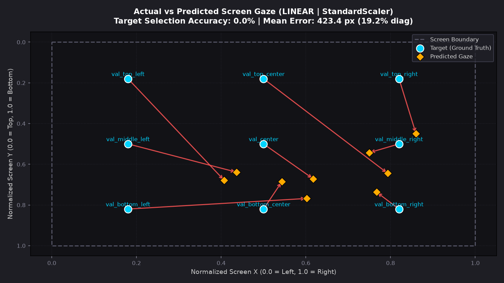
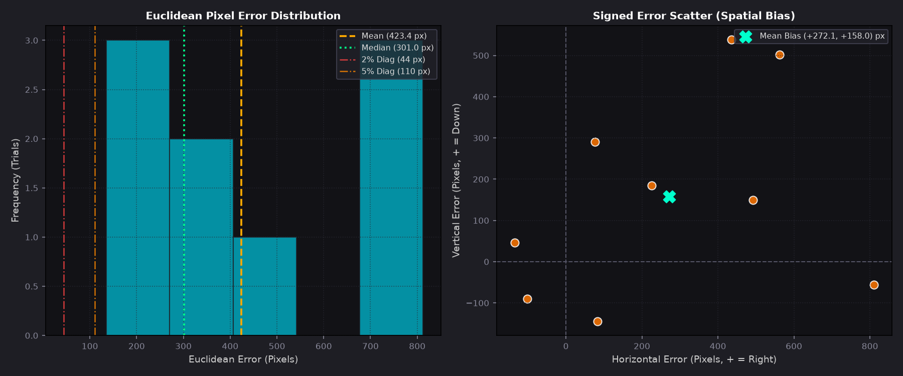
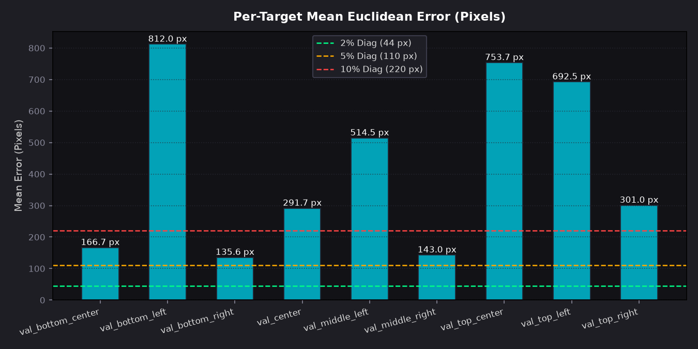

# Gaze Tracking Experiment Report: `experiment_20261124_232039`

## Experiment Overview

| Field | Value |
|---|---|
| **Experiment ID** | `experiment_20261124_232039` |
| **Date and Time** | 2026-11-24 23:21:16 |
| **Screen Resolution** | 1920x1080 (Diagonal: 2202.9 px) |
| **Calibration Model** | LINEAR |
| **Normalization Method** | StandardScaler |
| **Number of Training Samples** | 9 targets (225 accepted frames) |
| **Validation Status** | `COMPLETED` |
| **Number of Validation Trials** | 9 valid / 9 planned (0 rejected, 0.0% rej rate) |

## Main Results

> **Accuracy percentages** below measure how often gaze predictions landed successfully within strict screen tolerances or inside target boundaries (higher is better). **Average Error** measures distance from the true target (lower is better).

| Result | Value |
|---|---:|
| **Accuracy within 2%** | **0.0%** (0/9 trials, within 44.1 px) |
| **Accuracy within 5%** | **0.0%** (0/9 trials, within 110.1 px) |
| **Accuracy within 10%** | **33.3%** (3/9 trials, within 220.3 px) |
| **Target Selection Accuracy** | **0.0%** (0/9 hits) |
| **Average Error (pixels)** | 423.4 px |
| **Average Error (% of screen diagonal)** | 19.2% |
| **Rejected Trial Rate** | 0.0% (0/9) |

## Detailed Results

### Prediction Error Breakdown (Independent Validation Trials)

| Error Measurement | Pixels | Screen Diagonal / Normalized |
|---|---:|---:|
| **X-Axis MAE** | 324.7 px | 0.1691 norm |
| **Y-Axis MAE** | 222.6 px | 0.2061 norm |
| **X-Axis RMSE** | 407.9 px | 0.2124 norm |
| **Y-Axis RMSE** | 282.3 px | 0.2614 norm |
| **Median Error** | 301.0 px | 13.7% diag (0.2724 norm) |
| **Maximum Error** | 812.0 px | 36.9% diag (0.5491 norm) |
| **90th Percentile Error** | 765.4 px | — |

### Target Selection & Trial Counts

- **Target Boundary Evaluated:** Rendered Target Circle (radius 22 display px / 33.0 px @ 1920x1080)
- **Successful Selections (Hits):** 0
- **Failed Selections (Misses):** 9
- **Total Valid Trials:** 9
- **Rejected / Invalid Trials:** 0 (0.0%)

### Direction Accuracy Breakdown (LEFT / RIGHT / CENTER / UP / DOWN)

| Direction | Valid / Rej | Selection Accuracy | Within 5% | Mean Error (px) | Bias (X, Y) px |
|---|---:|---:|---:|---:|---:|
| `LEFT` | 3 / 0 | **0.0%** | 0.0% | 673.0 px | (+579.3, +210.7) |
| `RIGHT` | 3 / 0 | **0.0%** | 0.0% | 193.2 px | (-53.3, +82.6) |
| `CENTER` | 1 / 0 | **0.0%** | 0.0% | 291.7 px | (+225.3, +185.2) |
| `UP` | 3 / 0 | **0.0%** | 0.0% | 582.4 px | (+358.4, +443.6) |
| `DOWN` | 3 / 0 | **0.0%** | 0.0% | 371.4 px | (+263.7, -96.8) |

### Screen Region Accuracy Breakdown (Rows, Columns & Edges)

| Screen Region | Valid / Rej | Selection Accuracy | Within 5% | Mean Error (px) | Bias (X, Y) px |
|---|---:|---:|---:|---:|---:|
| `top_row` | 3 / 0 | **0.0%** | 0.0% | 582.4 px | (+358.4, +443.6) |
| `middle_row` | 3 / 0 | **0.0%** | 0.0% | 316.4 px | (+194.1, +127.2) |
| `bottom_row` | 3 / 0 | **0.0%** | 0.0% | 371.4 px | (+263.7, -96.8) |
| `left_column` | 3 / 0 | **0.0%** | 0.0% | 673.0 px | (+579.3, +210.7) |
| `center_column` | 3 / 0 | **0.0%** | 0.0% | 404.0 px | (+290.3, +180.7) |
| `right_column` | 3 / 0 | **0.0%** | 0.0% | 193.2 px | (-53.3, +82.6) |
| `edge_regions` | 8 / 0 | **0.0%** | 0.0% | 439.9 px | (+277.9, +154.6) |
| `center_region` | 1 / 0 | **0.0%** | 0.0% | 291.7 px | (+225.3, +185.2) |

### Per-Target Performance

| Target Point | Valid / Rejected | Hits / Valid | Target Selection Accuracy | Mean Error (px) | Bias (X, Y) px |
|---|---:|---:|---:|---:|---:|
| `val_bottom_center` | 1 / 0 | 0 / 1 | **0.0%** | 166.7 px | (+82.8, -144.7) |
| `val_bottom_left` | 1 / 0 | 0 / 1 | **0.0%** | 812.0 px | (+810.1, -56.2) |
| `val_bottom_right` | 1 / 0 | 0 / 1 | **0.0%** | 135.6 px | (-101.7, -89.6) |
| `val_center` | 1 / 0 | 0 / 1 | **0.0%** | 291.7 px | (+225.3, +185.2) |
| `val_middle_left` | 1 / 0 | 0 / 1 | **0.0%** | 514.5 px | (+492.2, +150.1) |
| `val_middle_right` | 1 / 0 | 0 / 1 | **0.0%** | 143.0 px | (-135.2, +46.5) |
| `val_top_center` | 1 / 0 | 0 / 1 | **0.0%** | 753.7 px | (+562.7, +501.5) |
| `val_top_left` | 1 / 0 | 0 / 1 | **0.0%** | 692.5 px | (+435.7, +538.3) |
| `val_top_right` | 1 / 0 | 0 / 1 | **0.0%** | 301.0 px | (+76.9, +291.0) |

### Training Performance vs. Independent Validation Performance

> **Note:** Training error only measures how tightly the model fits the 9 calibration points and must NOT be interpreted as real-world validation accuracy.

| Evaluation Split | Purpose | Mean Error (px) | Validation Accuracy |
|---|---|---:|---:|
| **Calibration Training Set** | Model fitting residual (training fit only) | 325.9 px | N/A (training split) |
| **Independent Validation Set** | Unseen test targets (real accuracy) | 423.4 px (19.2% diag) | 0.0% hits / 0.0% within 5% |

## Simple Explanation

Status: [COMPLETED]. The system successfully predicted gaze positions inside the target boundaries in 0 out of 9 valid trials (0.0%). Its average prediction error was 423.4 pixels (median: 301.0 px, 19.2% of the screen diagonal), and 0.0% of valid trials fell within 5% of the screen diagonal (0 out of 9). Weakest direction observed: LEFT (mean error 673.0 px); weakest screen region: left_column (mean error 673.0 px). No previous completed validation experiments are available yet for historical comparison.

## Comparison with Previous Experiments

| Experiment ID | Model | Norm | Sel Acc | Within 2% | Within 5% | Within 10% | Mean Error | Median | Rej % | Weakest Dir / Region | Status |
| :--- | :---: | :---: | :---: | :---: | :---: | :---: | :---: | :---: | :---: | :--- | :--- |
| `experiment_20261123_221716` | **POLYNOMIAL** | None | N/A | N/A | N/A | N/A | N/A | N/A | N/A | -- | Calibrated Only (No Validation) |
| `experiment_20261123_224241` | **POLYNOMIAL** | None | N/A | N/A | N/A | N/A | N/A | N/A | N/A | -- | Calibrated Only (No Validation) |
| `experiment_20261124_220355` | **POLYNOMIAL** | StandardScaler | N/A | N/A | N/A | N/A | N/A | N/A | N/A | -- | Calibrated Only (No Validation) |
| `experiment_20261124_221738` | **POLYNOMIAL** | StandardScaler | N/A | N/A | N/A | N/A | N/A | N/A | N/A | -- | Calibrated Only (No Validation) |
| `experiment_20261124_225435` | **LINEAR** | StandardScaler | N/A | N/A | N/A | N/A | N/A | N/A | N/A | -- | Calibrated Only (No Validation) |
| `experiment_20261124_225544` | **COMPACT_POLYNOMIAL** | StandardScaler | N/A | N/A | N/A | N/A | N/A | N/A | N/A | -- | Calibrated Only (No Validation) |
| `experiment_20261124_232039` | **LINEAR** | StandardScaler | 0.0% | 0.0% | 0.0% | 33.3% | **423.4 px** | 301.0 px | 0.0% | LEFT / left_column | Validated |

- **Best Validated Experiment:** `experiment_20261124_232039` (0.0% target selection, 423.4 px mean error) (weakest dir: LEFT, weakest region: left_column).
- **Trend:** Only 1 completed validation experiment available; run another validation session to compare improvement.

## Diagnostic Plots

