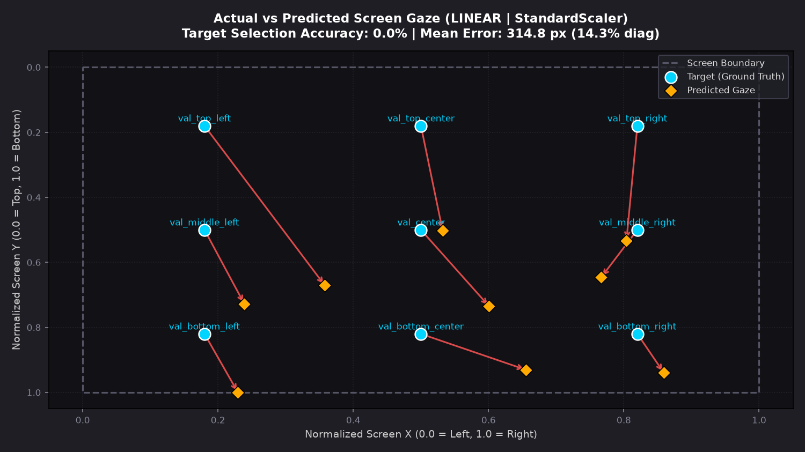
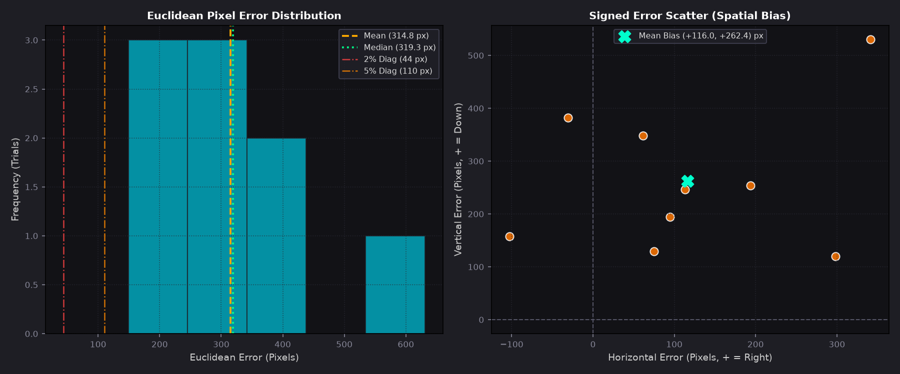
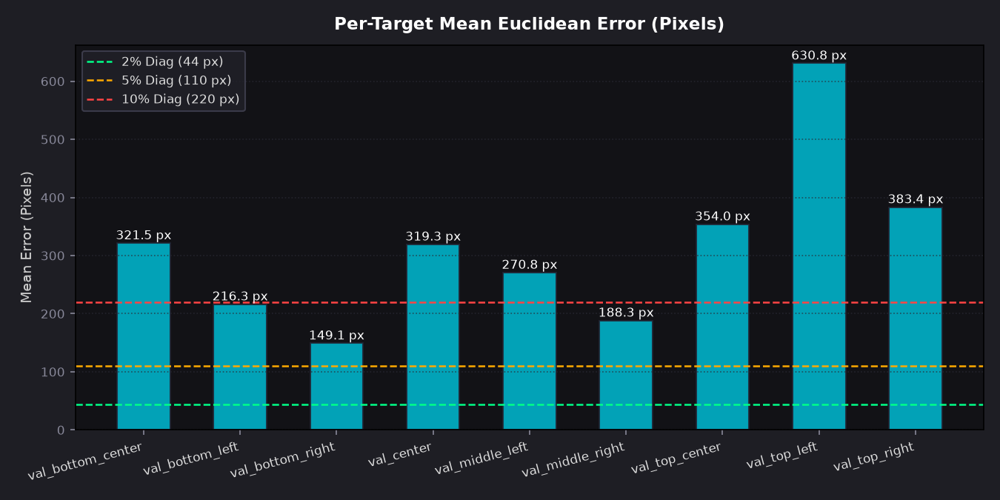

# Gaze Tracking Experiment Report: `experiment_20261124_232710`

## Experiment Overview

| Field | Value |
|---|---|
| **Experiment ID** | `experiment_20261124_232710` |
| **Date and Time** | 2026-11-24 23:27:48 |
| **Screen Resolution** | 1920x1080 (Diagonal: 2202.9 px) |
| **Calibration Model** | LINEAR |
| **Normalization Method** | StandardScaler |
| **Number of Training Samples** | 9 targets (213 accepted frames) |
| **Validation Status** | `COMPLETED` |
| **Number of Validation Trials** | 9 valid / 9 planned (0 rejected, 0.0% rej rate) |

## Main Results

> **Accuracy percentages** below measure how often gaze predictions landed successfully within strict screen tolerances or inside target boundaries (higher is better). **Average Error** measures distance from the true target (lower is better).

| Result | Value |
|---|---:|
| **Accuracy within 2%** | **0.0%** (0/9 trials, within 44.1 px) |
| **Accuracy within 5%** | **0.0%** (0/9 trials, within 110.1 px) |
| **Accuracy within 10%** | **33.3%** (3/9 trials, within 220.3 px) |
| **Target Selection Accuracy** | **0.0%** (0/9 hits) |
| **Average Error (pixels)** | 314.8 px |
| **Average Error (% of screen diagonal)** | 14.3% |
| **Rejected Trial Rate** | 0.0% (0/9) |

## Detailed Results

### Prediction Error Breakdown (Independent Validation Trials)

| Error Measurement | Pixels | Screen Diagonal / Normalized |
|---|---:|---:|
| **X-Axis MAE** | 145.7 px | 0.0759 norm |
| **Y-Axis MAE** | 262.4 px | 0.2430 norm |
| **X-Axis RMSE** | 178.2 px | 0.0928 norm |
| **Y-Axis RMSE** | 292.0 px | 0.2704 norm |
| **Median Error** | 319.3 px | 14.5% diag (0.2353 norm) |
| **Maximum Error** | 630.7 px | 28.6% diag (0.5222 norm) |
| **90th Percentile Error** | 432.9 px | — |

### Target Selection & Trial Counts

- **Target Boundary Evaluated:** Rendered Target Circle (radius 22 display px / 33.0 px @ 1920x1080)
- **Successful Selections (Hits):** 0
- **Failed Selections (Misses):** 9
- **Total Valid Trials:** 9
- **Rejected / Invalid Trials:** 0 (0.0%)

### Direction Accuracy Breakdown (LEFT / RIGHT / CENTER / UP / DOWN)

| Direction | Valid / Rej | Selection Accuracy | Within 5% | Mean Error (px) | Bias (X, Y) px |
|---|---:|---:|---:|---:|---:|
| `LEFT` | 3 / 0 | **0.0%** | 0.0% | 372.6 px | (+183.2, +323.6) |
| `RIGHT` | 3 / 0 | **0.0%** | 0.0% | 240.3 px | (-19.6, +223.0) |
| `CENTER` | 1 / 0 | **0.0%** | 0.0% | 319.3 px | (+193.6, +254.0) |
| `UP` | 3 / 0 | **0.0%** | 0.0% | 456.1 px | (+124.0, +420.4) |
| `DOWN` | 3 / 0 | **0.0%** | 0.0% | 228.9 px | (+156.1, +147.6) |

### Screen Region Accuracy Breakdown (Rows, Columns & Edges)

| Screen Region | Valid / Rej | Selection Accuracy | Within 5% | Mean Error (px) | Bias (X, Y) px |
|---|---:|---:|---:|---:|---:|
| `top_row` | 3 / 0 | **0.0%** | 0.0% | 456.1 px | (+124.0, +420.4) |
| `middle_row` | 3 / 0 | **0.0%** | 0.0% | 259.5 px | (+68.0, +219.3) |
| `bottom_row` | 3 / 0 | **0.0%** | 0.0% | 228.9 px | (+156.1, +147.6) |
| `left_column` | 3 / 0 | **0.0%** | 0.0% | 372.6 px | (+183.2, +323.6) |
| `center_column` | 3 / 0 | **0.0%** | 0.0% | 331.6 px | (+184.5, +240.7) |
| `right_column` | 3 / 0 | **0.0%** | 0.0% | 240.3 px | (-19.6, +223.0) |
| `edge_regions` | 8 / 0 | **0.0%** | 0.0% | 314.3 px | (+106.3, +263.5) |
| `center_region` | 1 / 0 | **0.0%** | 0.0% | 319.3 px | (+193.6, +254.0) |

### Per-Target Performance

| Target Point | Valid / Rejected | Hits / Valid | Target Selection Accuracy | Mean Error (px) | Bias (X, Y) px |
|---|---:|---:|---:|---:|---:|
| `val_bottom_center` | 1 / 0 | 0 / 1 | **0.0%** | 321.5 px | (+298.4, +119.5) |
| `val_bottom_left` | 1 / 0 | 0 / 1 | **0.0%** | 216.3 px | (+94.9, +194.4) |
| `val_bottom_right` | 1 / 0 | 0 / 1 | **0.0%** | 149.1 px | (+74.9, +128.9) |
| `val_center` | 1 / 0 | 0 / 1 | **0.0%** | 319.3 px | (+193.6, +254.0) |
| `val_middle_left` | 1 / 0 | 0 / 1 | **0.0%** | 270.8 px | (+113.0, +246.1) |
| `val_middle_right` | 1 / 0 | 0 / 1 | **0.0%** | 188.3 px | (-102.7, +157.9) |
| `val_top_center` | 1 / 0 | 0 / 1 | **0.0%** | 354.0 px | (+61.6, +348.6) |
| `val_top_left` | 1 / 0 | 0 / 1 | **0.0%** | 630.8 px | (+341.5, +530.3) |
| `val_top_right` | 1 / 0 | 0 / 1 | **0.0%** | 383.4 px | (-31.1, +382.2) |

### Training Performance vs. Independent Validation Performance

> **Note:** Training error only measures how tightly the model fits the 9 calibration points and must NOT be interpreted as real-world validation accuracy.

| Evaluation Split | Purpose | Mean Error (px) | Validation Accuracy |
|---|---|---:|---:|
| **Calibration Training Set** | Model fitting residual (training fit only) | 125.2 px | N/A (training split) |
| **Independent Validation Set** | Unseen test targets (real accuracy) | 314.8 px (14.3% diag) | 0.0% hits / 0.0% within 5% |

## Simple Explanation

Status: [COMPLETED]. The system successfully predicted gaze positions inside the target boundaries in 0 out of 9 valid trials (0.0%). Its average prediction error was 314.8 pixels (median: 319.3 px, 14.3% of the screen diagonal), and 0.0% of valid trials fell within 5% of the screen diagonal (0 out of 9). Weakest direction observed: UP (mean error 456.1 px); weakest screen region: top_row (mean error 456.1 px). This experiment performed better than the previous validated experiment (experiment_20261124_232039) according to the independent validation results (average error changed from 423.4 px to 314.8 px (25.6% error reduction); target selection accuracy changed from 0.0% to 0.0% (+0.0 percentage points)).

## Comparison with Previous Experiments

| Experiment ID | Model | Norm | Sel Acc | Within 2% | Within 5% | Within 10% | Mean Error | Median | Rej % | Weakest Dir / Region | Status |
| :--- | :---: | :---: | :---: | :---: | :---: | :---: | :---: | :---: | :---: | :--- | :--- |
| `experiment_20261123_221716` | **POLYNOMIAL** | None | N/A | N/A | N/A | N/A | N/A | N/A | N/A | -- | Calibrated Only (No Validation) |
| `experiment_20261123_224241` | **POLYNOMIAL** | None | N/A | N/A | N/A | N/A | N/A | N/A | N/A | -- | Calibrated Only (No Validation) |
| `experiment_20261124_220355` | **POLYNOMIAL** | StandardScaler | N/A | N/A | N/A | N/A | N/A | N/A | N/A | -- | Calibrated Only (No Validation) |
| `experiment_20261124_221738` | **POLYNOMIAL** | StandardScaler | N/A | N/A | N/A | N/A | N/A | N/A | N/A | -- | Calibrated Only (No Validation) |
| `experiment_20261124_225435` | **LINEAR** | StandardScaler | N/A | N/A | N/A | N/A | N/A | N/A | N/A | -- | Calibrated Only (No Validation) |
| `experiment_20261124_225544` | **COMPACT_POLYNOMIAL** | StandardScaler | N/A | N/A | N/A | N/A | N/A | N/A | N/A | -- | Calibrated Only (No Validation) |
| `experiment_20261124_232039` | **LINEAR** | StandardScaler | 0.0% | 0.0% | 0.0% | 33.3% | **423.4 px** | 301.0 px | 0.0% | LEFT / left_column | Validated |
| `experiment_20261124_232710` | **LINEAR** | StandardScaler | 0.0% | 0.0% | 0.0% | 33.3% | **314.8 px** | 319.3 px | 0.0% | UP / top_row | Validated |

- **Best Validated Experiment:** `experiment_20261124_232710` (0.0% target selection, 314.8 px mean error) (weakest dir: UP, weakest region: top_row).
- **Latest vs. Previous Validated (`experiment_20261124_232710` vs `experiment_20261124_232039`):** **IMPROVED** (Mean Error -108.6 px (25.6% error reduction); Target Selection Accuracy +0.0 percentage points; Within 5% Accuracy +0.0 percentage points).

## Diagnostic Plots

