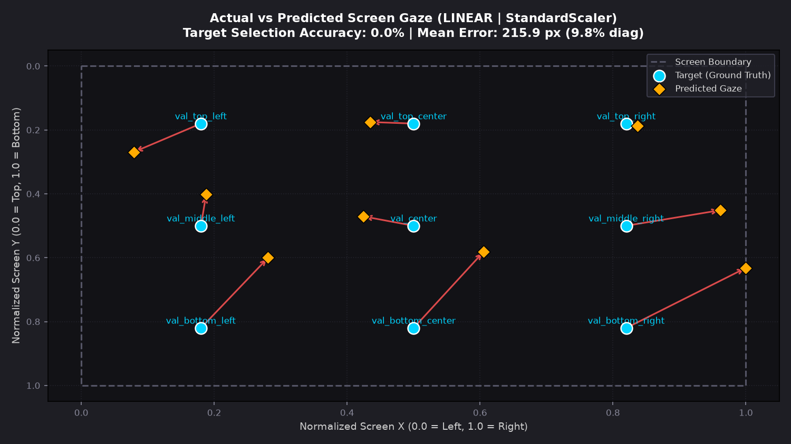
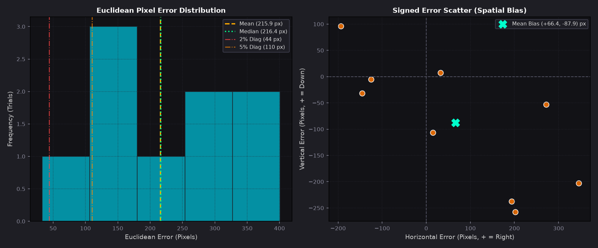
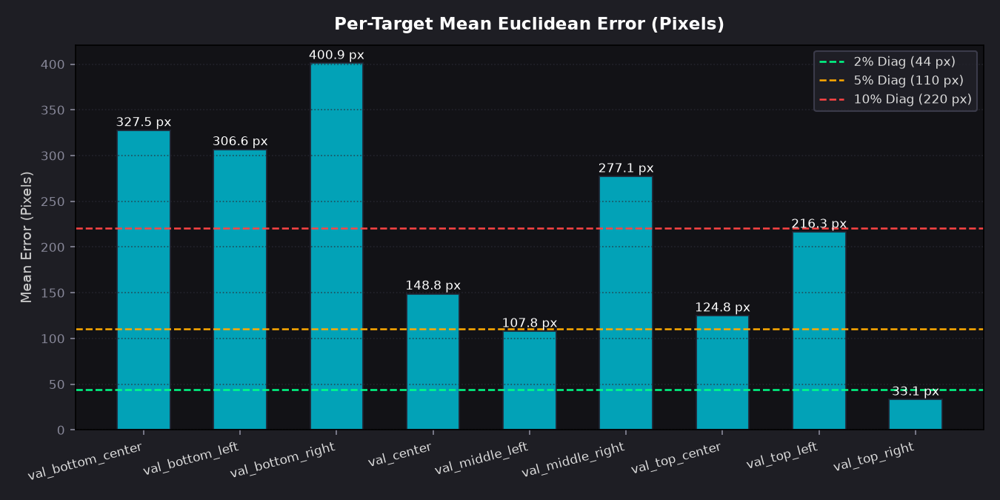

# Gaze Tracking Experiment Report: `experiment_20261125_142358`

## Experiment Overview

| Field | Value |
|---|---|
| **Experiment ID** | `experiment_20261125_142358` |
| **Date and Time** | 2026-11-25 14:24:35 |
| **Screen Resolution** | 1920x1080 (Diagonal: 2202.9 px) |
| **Calibration Model** | LINEAR |
| **Normalization Method** | StandardScaler |
| **Number of Training Samples** | 9 targets (259 accepted frames) |
| **Validation Status** | `COMPLETED` |
| **Number of Validation Trials** | 9 valid / 9 planned (0 rejected, 0.0% rej rate) |

## Main Results

> **Accuracy percentages** below measure how often gaze predictions landed successfully within strict screen tolerances or inside target boundaries (higher is better). **Average Error** measures distance from the true target (lower is better).

| Result | Value |
|---|---:|
| **Accuracy within 2%** | **11.1%** (1/9 trials, within 44.1 px) |
| **Accuracy within 5%** | **22.2%** (2/9 trials, within 110.1 px) |
| **Accuracy within 10%** | **55.6%** (5/9 trials, within 220.3 px) |
| **Target Selection Accuracy** | **0.0%** (0/9 hits) |
| **Average Error (pixels)** | 215.9 px |
| **Average Error (% of screen diagonal)** | 9.8% |
| **Rejected Trial Rate** | 0.0% (0/9) |

## Detailed Results

### Prediction Error Breakdown (Independent Validation Trials)

| Error Measurement | Pixels | Screen Diagonal / Normalized |
|---|---:|---:|
| **X-Axis MAE** | 169.5 px | 0.0883 norm |
| **Y-Axis MAE** | 110.9 px | 0.1027 norm |
| **X-Axis RMSE** | 196.5 px | 0.1023 norm |
| **Y-Axis RMSE** | 144.7 px | 0.1340 norm |
| **Median Error** | 216.4 px | 9.8% diag (0.1346 norm) |
| **Maximum Error** | 400.9 px | 18.2% diag (0.2608 norm) |
| **90th Percentile Error** | 342.2 px | — |

### Target Selection & Trial Counts

- **Target Boundary Evaluated:** Rendered Target Circle (radius 22 display px / 33.0 px @ 1920x1080)
- **Successful Selections (Hits):** 0
- **Failed Selections (Misses):** 9
- **Total Valid Trials:** 9
- **Rejected / Invalid Trials:** 0 (0.0%)

### Direction Accuracy Breakdown (LEFT / RIGHT / CENTER / UP / DOWN)

| Direction | Valid / Rej | Selection Accuracy | Within 5% | Mean Error (px) | Bias (X, Y) px |
|---|---:|---:|---:|---:|---:|
| `LEFT` | 3 / 0 | **0.0%** | 33.3% | 210.2 px | (+5.1, -82.7) |
| `RIGHT` | 3 / 0 | **0.0%** | 33.3% | 237.0 px | (+216.6, -82.9) |
| `CENTER` | 1 / 0 | **0.0%** | 0.0% | 148.8 px | (-145.4, -31.8) |
| `UP` | 3 / 0 | **0.0%** | 33.3% | 124.8 px | (-95.4, +32.7) |
| `DOWN` | 3 / 0 | **0.0%** | 0.0% | 345.0 px | (+247.2, -232.7) |

### Screen Region Accuracy Breakdown (Rows, Columns & Edges)

| Screen Region | Valid / Rej | Selection Accuracy | Within 5% | Mean Error (px) | Bias (X, Y) px |
|---|---:|---:|---:|---:|---:|
| `top_row` | 3 / 0 | **0.0%** | 33.3% | 124.8 px | (-95.4, +32.7) |
| `middle_row` | 3 / 0 | **0.0%** | 33.3% | 177.9 px | (+47.3, -63.8) |
| `bottom_row` | 3 / 0 | **0.0%** | 0.0% | 345.0 px | (+247.2, -232.7) |
| `left_column` | 3 / 0 | **0.0%** | 33.3% | 210.2 px | (+5.1, -82.7) |
| `center_column` | 3 / 0 | **0.0%** | 0.0% | 200.4 px | (-22.7, -98.2) |
| `right_column` | 3 / 0 | **0.0%** | 33.3% | 237.0 px | (+216.6, -82.9) |
| `edge_regions` | 8 / 0 | **0.0%** | 25.0% | 224.3 px | (+92.8, -94.9) |
| `center_region` | 1 / 0 | **0.0%** | 0.0% | 148.8 px | (-145.4, -31.8) |

### Per-Target Performance

| Target Point | Valid / Rejected | Hits / Valid | Target Selection Accuracy | Mean Error (px) | Bias (X, Y) px |
|---|---:|---:|---:|---:|---:|
| `val_bottom_center` | 1 / 0 | 0 / 1 | **0.0%** | 327.5 px | (+202.1, -257.7) |
| `val_bottom_left` | 1 / 0 | 0 / 1 | **0.0%** | 306.6 px | (+194.0, -237.4) |
| `val_bottom_right` | 1 / 0 | 0 / 1 | **0.0%** | 400.9 px | (+345.6, -203.1) |
| `val_center` | 1 / 0 | 0 / 1 | **0.0%** | 148.8 px | (-145.4, -31.8) |
| `val_middle_left` | 1 / 0 | 0 / 1 | **0.0%** | 107.8 px | (+15.2, -106.7) |
| `val_middle_right` | 1 / 0 | 0 / 1 | **0.0%** | 277.1 px | (+272.0, -52.8) |
| `val_top_center` | 1 / 0 | 0 / 1 | **0.0%** | 124.8 px | (-124.7, -5.2) |
| `val_top_left` | 1 / 0 | 0 / 1 | **0.0%** | 216.3 px | (-193.8, +96.1) |
| `val_top_right` | 1 / 0 | 0 / 1 | **0.0%** | 33.1 px | (+32.3, +7.3) |

### Training Performance vs. Independent Validation Performance

> **Note:** Training error only measures how tightly the model fits the 9 calibration points and must NOT be interpreted as real-world validation accuracy.

| Evaluation Split | Purpose | Mean Error (px) | Validation Accuracy |
|---|---|---:|---:|
| **Calibration Training Set** | Model fitting residual (training fit only) | 20.5 px | N/A (training split) |
| **Independent Validation Set** | Unseen test targets (real accuracy) | 215.9 px (9.8% diag) | 0.0% hits / 22.2% within 5% |

## Simple Explanation

Status: [COMPLETED]. The system successfully predicted gaze positions inside the target boundaries in 0 out of 9 valid trials (0.0%). Its average prediction error was 215.9 pixels (median: 216.4 px, 9.8% of the screen diagonal), and 22.2% of valid trials fell within 5% of the screen diagonal (2 out of 9). Weakest direction observed: DOWN (mean error 345.0 px); weakest screen region: bottom_row (mean error 345.0 px). This experiment performed better than the previous validated experiment (experiment_20261125_141825) according to the independent validation results (average error changed from 312.0 px to 215.9 px (30.8% error reduction); target selection accuracy changed from 0.0% to 0.0% (+0.0 percentage points)).

## Comparison with Previous Experiments

| Experiment ID | Model | Norm | Sel Acc | Within 2% | Within 5% | Within 10% | Mean Error | Median | Rej % | Weakest Dir / Region | Status |
| :--- | :---: | :---: | :---: | :---: | :---: | :---: | :---: | :---: | :---: | :--- | :--- |
| `experiment_20261123_221716` | **POLYNOMIAL** | None | N/A | N/A | N/A | N/A | N/A | N/A | N/A | -- | Calibrated Only (No Validation) |
| `experiment_20261123_224241` | **POLYNOMIAL** | None | N/A | N/A | N/A | N/A | N/A | N/A | N/A | -- | Calibrated Only (No Validation) |
| `experiment_20261124_220355` | **POLYNOMIAL** | StandardScaler | N/A | N/A | N/A | N/A | N/A | N/A | N/A | -- | Calibrated Only (No Validation) |
| `experiment_20261124_221738` | **POLYNOMIAL** | StandardScaler | N/A | N/A | N/A | N/A | N/A | N/A | N/A | -- | Calibrated Only (No Validation) |
| `experiment_20261124_225435` | **LINEAR** | StandardScaler | N/A | N/A | N/A | N/A | N/A | N/A | N/A | -- | Calibrated Only (No Validation) |
| `experiment_20261124_225544` | **COMPACT_POLYNOMIAL** | StandardScaler | N/A | N/A | N/A | N/A | N/A | N/A | N/A | -- | Calibrated Only (No Validation) |
| `experiment_20261124_232039` | **LINEAR** | StandardScaler | 0.0% | 0.0% | 0.0% | 33.3% | **423.4 px** | 301.0 px | 0.0% | LEFT / left_column | Validated |
| `experiment_20261124_232710` | **LINEAR** | StandardScaler | 0.0% | 0.0% | 0.0% | 33.3% | **314.8 px** | 319.3 px | 0.0% | UP / top_row | Validated |
| `experiment_20261125_141825` | **COMPACT_LINEAR** | StandardScaler | 0.0% | 0.0% | 0.0% | 33.3% | **312.0 px** | 274.1 px | 0.0% | RIGHT / right_column | Validated |
| `experiment_20261125_142358` | **LINEAR** | StandardScaler | 0.0% | 11.1% | 22.2% | 55.6% | **215.9 px** | 216.3 px | 0.0% | DOWN / bottom_row | Validated |

- **Best Validated Experiment:** `experiment_20261125_142358` (0.0% target selection, 215.9 px mean error) (weakest dir: DOWN, weakest region: bottom_row).
- **Latest vs. Previous Validated (`experiment_20261125_142358` vs `experiment_20261125_141825`):** **IMPROVED** (Mean Error -96.1 px (30.8% error reduction); Target Selection Accuracy +0.0 percentage points; Within 5% Accuracy +22.2 percentage points).

## Diagnostic Plots

