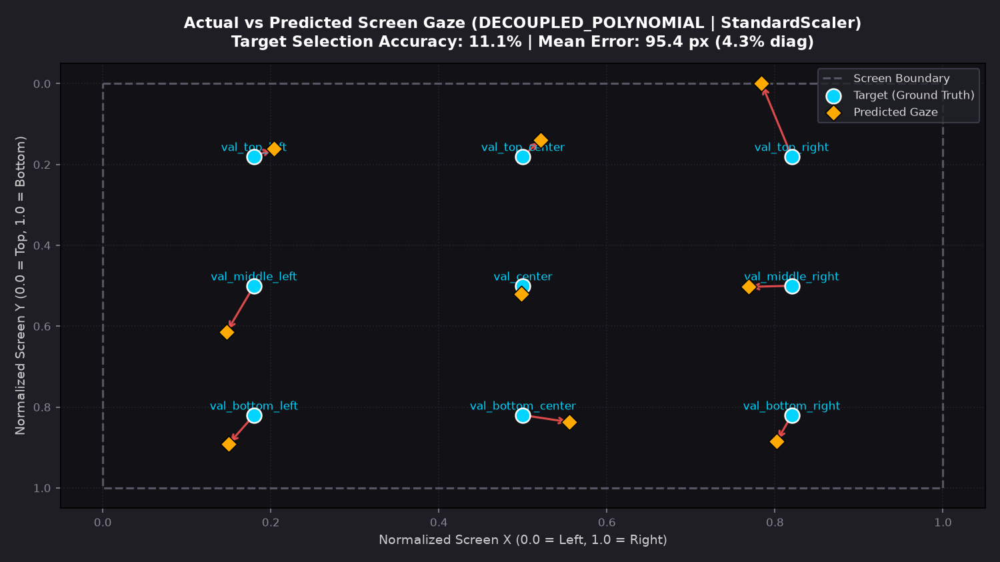
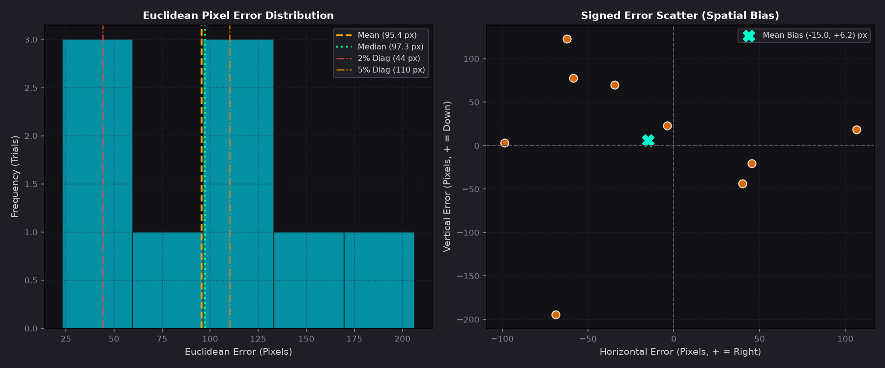
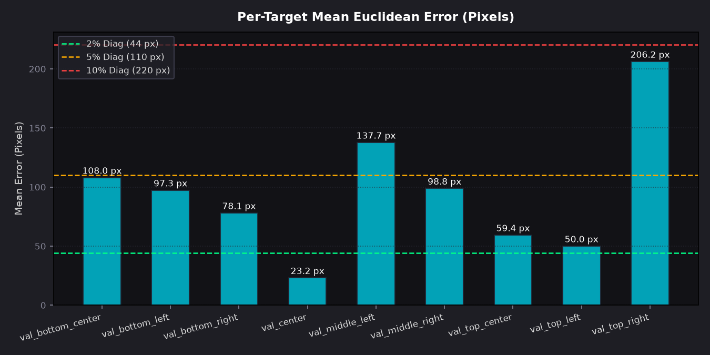

# Gaze Tracking Experiment Report: `experiment_20261125_150223`

## Experiment Overview

| Field | Value |
|---|---|
| **Experiment ID** | `experiment_20261125_150223` |
| **Date and Time** | 2026-11-25 15:03:00 |
| **Screen Resolution** | 1920x1080 (Diagonal: 2202.9 px) |
| **Calibration Model** | DECOUPLED_POLYNOMIAL |
| **Normalization Method** | StandardScaler |
| **Number of Training Samples** | 9 targets (249 accepted frames) |
| **Validation Status** | `COMPLETED` |
| **Number of Validation Trials** | 9 valid / 9 planned (0 rejected, 0.0% rej rate) |

## Main Results

> **Accuracy percentages** below measure how often gaze predictions landed successfully within strict screen tolerances or inside target boundaries (higher is better). **Average Error** measures distance from the true target (lower is better).

| Result | Value |
|---|---:|
| **Accuracy within 2%** | **11.1%** (1/9 trials, within 44.1 px) |
| **Accuracy within 5%** | **77.8%** (7/9 trials, within 110.1 px) |
| **Accuracy within 10%** | **100.0%** (9/9 trials, within 220.3 px) |
| **Target Selection Accuracy** | **11.1%** (1/9 hits) |
| **Average Error (pixels)** | 95.4 px |
| **Average Error (% of screen diagonal)** | 4.3% |
| **Rejected Trial Rate** | 0.0% (0/9) |

## Detailed Results

### Prediction Error Breakdown (Independent Validation Trials)

| Error Measurement | Pixels | Screen Diagonal / Normalized |
|---|---:|---:|
| **X-Axis MAE** | 57.7 px | 0.0300 norm |
| **Y-Axis MAE** | 63.8 px | 0.0591 norm |
| **X-Axis RMSE** | 65.0 px | 0.0339 norm |
| **Y-Axis RMSE** | 86.3 px | 0.0799 norm |
| **Median Error** | 97.3 px | 4.4% diag (0.0581 norm) |
| **Maximum Error** | 206.2 px | 9.4% diag (0.1835 norm) |
| **90th Percentile Error** | 151.4 px | — |

### Target Selection & Trial Counts

- **Target Boundary Evaluated:** Rendered Target Circle (radius 22 display px / 33.0 px @ 1920x1080)
- **Successful Selections (Hits):** 1
- **Failed Selections (Misses):** 8
- **Total Valid Trials:** 9
- **Rejected / Invalid Trials:** 0 (0.0%)

### Direction Accuracy Breakdown (LEFT / RIGHT / CENTER / UP / DOWN)

| Direction | Valid / Rej | Selection Accuracy | Within 5% | Mean Error (px) | Bias (X, Y) px |
|---|---:|---:|---:|---:|---:|
| `LEFT` | 3 / 0 | **0.0%** | 66.7% | 95.0 px | (-25.1, +60.0) |
| `RIGHT` | 3 / 0 | **0.0%** | 66.7% | 127.7 px | (-67.4, -40.5) |
| `CENTER` | 1 / 0 | **100.0%** | 100.0% | 23.2 px | (-4.0, +22.8) |
| `UP` | 3 / 0 | **0.0%** | 66.7% | 105.2 px | (+5.6, -86.3) |
| `DOWN` | 3 / 0 | **0.0%** | 100.0% | 94.5 px | (+4.4, +55.5) |

### Screen Region Accuracy Breakdown (Rows, Columns & Edges)

| Screen Region | Valid / Rej | Selection Accuracy | Within 5% | Mean Error (px) | Bias (X, Y) px |
|---|---:|---:|---:|---:|---:|
| `top_row` | 3 / 0 | **0.0%** | 66.7% | 105.2 px | (+5.6, -86.3) |
| `middle_row` | 3 / 0 | **33.3%** | 66.7% | 86.6 px | (-55.0, +49.6) |
| `bottom_row` | 3 / 0 | **0.0%** | 100.0% | 94.5 px | (+4.4, +55.5) |
| `left_column` | 3 / 0 | **0.0%** | 66.7% | 95.0 px | (-25.1, +60.0) |
| `center_column` | 3 / 0 | **33.3%** | 100.0% | 63.5 px | (+47.5, -0.8) |
| `right_column` | 3 / 0 | **0.0%** | 66.7% | 127.7 px | (-67.4, -40.5) |
| `edge_regions` | 8 / 0 | **0.0%** | 75.0% | 104.5 px | (-16.4, +4.2) |
| `center_region` | 1 / 0 | **100.0%** | 100.0% | 23.2 px | (-4.0, +22.8) |

### Per-Target Performance

| Target Point | Valid / Rejected | Hits / Valid | Target Selection Accuracy | Mean Error (px) | Bias (X, Y) px |
|---|---:|---:|---:|---:|---:|
| `val_bottom_center` | 1 / 0 | 0 / 1 | **0.0%** | 108.0 px | (+106.4, +18.7) |
| `val_bottom_left` | 1 / 0 | 0 / 1 | **0.0%** | 97.3 px | (-58.6, +77.7) |
| `val_bottom_right` | 1 / 0 | 0 / 1 | **0.0%** | 78.1 px | (-34.6, +70.0) |
| `val_center` | 1 / 0 | 1 / 1 | **100.0%** | 23.2 px | (-4.0, +22.8) |
| `val_middle_left` | 1 / 0 | 0 / 1 | **0.0%** | 137.7 px | (-62.3, +122.8) |
| `val_middle_right` | 1 / 0 | 0 / 1 | **0.0%** | 98.8 px | (-98.8, +3.0) |
| `val_top_center` | 1 / 0 | 0 / 1 | **0.0%** | 59.4 px | (+40.1, -43.8) |
| `val_top_left` | 1 / 0 | 0 / 1 | **0.0%** | 50.0 px | (+45.5, -20.7) |
| `val_top_right` | 1 / 0 | 0 / 1 | **0.0%** | 206.2 px | (-68.9, -194.4) |

### Training Performance vs. Independent Validation Performance

> **Note:** Training error only measures how tightly the model fits the 9 calibration points and must NOT be interpreted as real-world validation accuracy.

| Evaluation Split | Purpose | Mean Error (px) | Validation Accuracy |
|---|---|---:|---:|
| **Calibration Training Set** | Model fitting residual (training fit only) | 121.0 px | N/A (training split) |
| **Independent Validation Set** | Unseen test targets (real accuracy) | 95.4 px (4.3% diag) | 11.1% hits / 77.8% within 5% |

## Simple Explanation

Status: [COMPLETED]. The system successfully predicted gaze positions inside the target boundaries in 1 out of 9 valid trials (11.1%). Its average prediction error was 95.4 pixels (median: 97.3 px, 4.3% of the screen diagonal), and 77.8% of valid trials fell within 5% of the screen diagonal (7 out of 9). Weakest direction observed: RIGHT (mean error 127.7 px); weakest screen region: right_column (mean error 127.7 px). This experiment performed better than the previous validated experiment (experiment_20261125_150006) according to the independent validation results (average error changed from 177.0 px to 95.4 px (46.1% error reduction); target selection accuracy changed from 0.0% to 11.1% (+11.1 percentage points)).

## Comparison with Previous Experiments

| Experiment ID | Model | Norm | Sel Acc | Within 2% | Within 5% | Within 10% | Mean Error | Median | Rej % | Weakest Dir / Region | Status |
| :--- | :---: | :---: | :---: | :---: | :---: | :---: | :---: | :---: | :---: | :--- | :--- |
| `experiment_20261123_221716` | **POLYNOMIAL** | None | N/A | N/A | N/A | N/A | N/A | N/A | N/A | -- | Calibrated Only (No Validation) |
| `experiment_20261123_224241` | **POLYNOMIAL** | None | N/A | N/A | N/A | N/A | N/A | N/A | N/A | -- | Calibrated Only (No Validation) |
| `experiment_20261124_220355` | **POLYNOMIAL** | StandardScaler | N/A | N/A | N/A | N/A | N/A | N/A | N/A | -- | Calibrated Only (No Validation) |
| `experiment_20261124_221738` | **POLYNOMIAL** | StandardScaler | N/A | N/A | N/A | N/A | N/A | N/A | N/A | -- | Calibrated Only (No Validation) |
| `experiment_20261124_225435` | **LINEAR** | StandardScaler | N/A | N/A | N/A | N/A | N/A | N/A | N/A | -- | Calibrated Only (No Validation) |
| `experiment_20261124_225544` | **COMPACT_POLYNOMIAL** | StandardScaler | N/A | N/A | N/A | N/A | N/A | N/A | N/A | -- | Calibrated Only (No Validation) |
| `experiment_20261124_232039` | **LINEAR** | StandardScaler | 0.0% | 0.0% | 0.0% | 33.3% | **423.4 px** | 301.0 px | 0.0% | LEFT / left_column | Validated |
| `experiment_20261124_232710` | **LINEAR** | StandardScaler | 0.0% | 0.0% | 0.0% | 33.3% | **314.8 px** | 319.3 px | 0.0% | UP / top_row | Validated |
| `experiment_20261125_141825` | **COMPACT_LINEAR** | StandardScaler | 0.0% | 0.0% | 0.0% | 33.3% | **312.0 px** | 274.1 px | 0.0% | RIGHT / right_column | Validated |
| `experiment_20261125_142358` | **LINEAR** | StandardScaler | 0.0% | 11.1% | 22.2% | 55.6% | **215.9 px** | 216.3 px | 0.0% | DOWN / bottom_row | Validated |
| `experiment_20261125_150006` | **LINEAR** | StandardScaler | 0.0% | 0.0% | 0.0% | 66.7% | **177.0 px** | 163.5 px | 0.0% | LEFT / left_column | Validated |
| `experiment_20261125_150223` | **DECOUPLED_POLYNOMIAL** | StandardScaler | 11.1% | 11.1% | 77.8% | 100.0% | **95.4 px** | 97.3 px | 0.0% | RIGHT / right_column | Validated |

- **Best Validated Experiment:** `experiment_20261125_150223` (11.1% target selection, 95.4 px mean error) (weakest dir: RIGHT, weakest region: right_column).
- **Latest vs. Previous Validated (`experiment_20261125_150223` vs `experiment_20261125_150006`):** **IMPROVED** (Mean Error -81.5 px (46.1% error reduction); Target Selection Accuracy +11.1 percentage points; Within 5% Accuracy +77.8 percentage points).

## Diagnostic Plots

