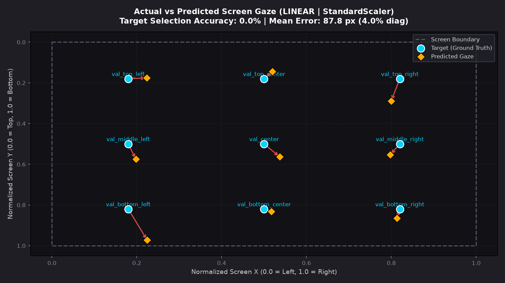
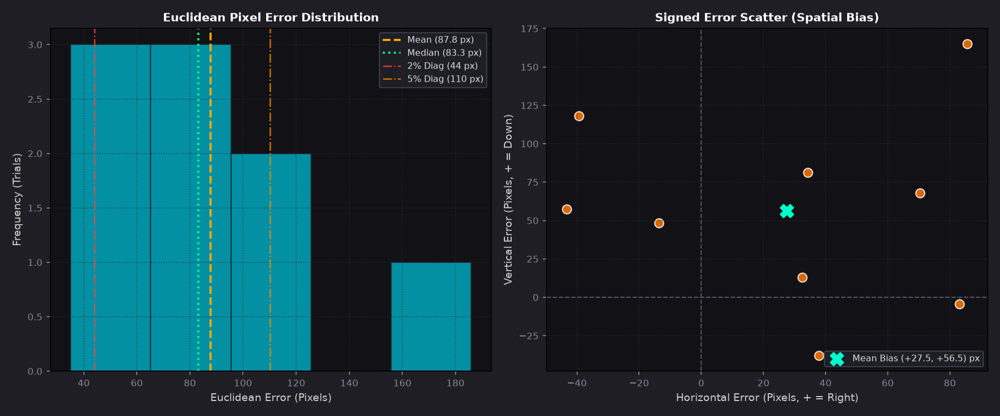
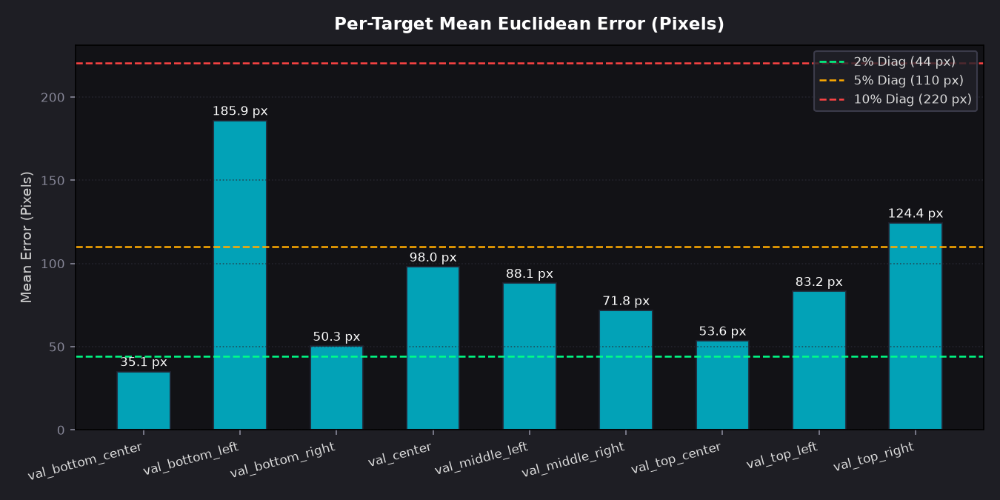

# Gaze Tracking Experiment Report: `experiment_20261125_153718`

## Experiment Overview

| Field | Value |
|---|---|
| **Experiment ID** | `experiment_20261125_153718` |
| **Date and Time** | 2026-11-25 15:38:00 |
| **Screen Resolution** | 1920x1080 (Diagonal: 2202.9 px) |
| **Calibration Model** | LINEAR |
| **Normalization Method** | StandardScaler |
| **Number of Training Samples** | 9 targets (170 accepted frames) |
| **Validation Status** | `COMPLETED` |
| **Number of Validation Trials** | 9 valid / 9 planned (0 rejected, 0.0% rej rate) |

## Main Results

> **Accuracy percentages** below measure how often gaze predictions landed successfully within strict screen tolerances or inside target boundaries (higher is better). **Average Error** measures distance from the true target (lower is better).

| Result | Value |
|---|---:|
| **Accuracy within 2%** | **11.1%** (1/9 trials, within 44.1 px) |
| **Accuracy within 5%** | **77.8%** (7/9 trials, within 110.1 px) |
| **Accuracy within 10%** | **100.0%** (9/9 trials, within 220.3 px) |
| **Target Selection Accuracy** | **0.0%** (0/9 hits) |
| **Average Error (pixels)** | 87.8 px |
| **Average Error (% of screen diagonal)** | 4.0% |
| **Rejected Trial Rate** | 0.0% (0/9) |

## Detailed Results

### Prediction Error Breakdown (Independent Validation Trials)

| Error Measurement | Pixels | Screen Diagonal / Normalized |
|---|---:|---:|
| **X-Axis MAE** | 48.9 px | 0.0255 norm |
| **Y-Axis MAE** | 66.0 px | 0.0611 norm |
| **X-Axis RMSE** | 54.2 px | 0.0282 norm |
| **Y-Axis RMSE** | 81.4 px | 0.0754 norm |
| **Median Error** | 83.3 px | 3.8% diag (0.0576 norm) |
| **Maximum Error** | 185.9 px | 8.4% diag (0.1592 norm) |
| **90th Percentile Error** | 136.7 px | — |

### Target Selection & Trial Counts

- **Target Boundary Evaluated:** Rendered Target Circle (radius 22 display px / 22.0 px @ 1920x1080)
- **Successful Selections (Hits):** 0
- **Failed Selections (Misses):** 9
- **Total Valid Trials:** 9
- **Rejected / Invalid Trials:** 0 (0.0%)

### Direction Accuracy Breakdown (LEFT / RIGHT / CENTER / UP / DOWN)

| Direction | Valid / Rej | Selection Accuracy | Within 5% | Mean Error (px) | Bias (X, Y) px |
|---|---:|---:|---:|---:|---:|
| `LEFT` | 3 / 0 | **0.0%** | 66.7% | 119.1 px | (+67.7, +80.6) |
| `RIGHT` | 3 / 0 | **0.0%** | 66.7% | 82.2 px | (-32.1, +74.6) |
| `CENTER` | 1 / 0 | **0.0%** | 100.0% | 98.0 px | (+70.4, +68.1) |
| `UP` | 3 / 0 | **0.0%** | 66.7% | 87.1 px | (+27.2, +25.2) |
| `DOWN` | 3 / 0 | **0.0%** | 66.7% | 90.5 px | (+34.9, +75.5) |

### Screen Region Accuracy Breakdown (Rows, Columns & Edges)

| Screen Region | Valid / Rej | Selection Accuracy | Within 5% | Mean Error (px) | Bias (X, Y) px |
|---|---:|---:|---:|---:|---:|
| `top_row` | 3 / 0 | **0.0%** | 66.7% | 87.1 px | (+27.2, +25.2) |
| `middle_row` | 3 / 0 | **0.0%** | 100.0% | 86.0 px | (+20.5, +68.9) |
| `bottom_row` | 3 / 0 | **0.0%** | 66.7% | 90.5 px | (+34.9, +75.5) |
| `left_column` | 3 / 0 | **0.0%** | 66.7% | 119.1 px | (+67.7, +80.6) |
| `center_column` | 3 / 0 | **0.0%** | 100.0% | 62.2 px | (+46.9, +14.4) |
| `right_column` | 3 / 0 | **0.0%** | 66.7% | 82.2 px | (-32.1, +74.6) |
| `edge_regions` | 8 / 0 | **0.0%** | 75.0% | 86.6 px | (+22.2, +55.1) |
| `center_region` | 1 / 0 | **0.0%** | 100.0% | 98.0 px | (+70.4, +68.1) |

### Per-Target Performance

| Target Point | Valid / Rejected | Hits / Valid | Target Selection Accuracy | Mean Error (px) | Bias (X, Y) px |
|---|---:|---:|---:|---:|---:|
| `val_bottom_center` | 1 / 0 | 0 / 1 | **0.0%** | 35.1 px | (+32.5, +13.1) |
| `val_bottom_left` | 1 / 0 | 0 / 1 | **0.0%** | 185.9 px | (+85.7, +165.0) |
| `val_bottom_right` | 1 / 0 | 0 / 1 | **0.0%** | 50.3 px | (-13.6, +48.4) |
| `val_center` | 1 / 0 | 0 / 1 | **0.0%** | 98.0 px | (+70.4, +68.1) |
| `val_middle_left` | 1 / 0 | 0 / 1 | **0.0%** | 88.1 px | (+34.3, +81.2) |
| `val_middle_right` | 1 / 0 | 0 / 1 | **0.0%** | 71.8 px | (-43.2, +57.3) |
| `val_top_center` | 1 / 0 | 0 / 1 | **0.0%** | 53.6 px | (+37.8, -38.0) |
| `val_top_left` | 1 / 0 | 0 / 1 | **0.0%** | 83.2 px | (+83.1, -4.5) |
| `val_top_right` | 1 / 0 | 0 / 1 | **0.0%** | 124.4 px | (-39.3, +118.0) |

### Training Performance vs. Independent Validation Performance

> **Note:** Training error only measures how tightly the model fits the 9 calibration points and must NOT be interpreted as real-world validation accuracy.

| Evaluation Split | Purpose | Mean Error (px) | Validation Accuracy |
|---|---|---:|---:|
| **Calibration Training Set** | Model fitting residual (training fit only) | 86.2 px | N/A (training split) |
| **Independent Validation Set** | Unseen test targets (real accuracy) | 87.8 px (4.0% diag) | 0.0% hits / 77.8% within 5% |

## Simple Explanation

Status: [COMPLETED]. The system successfully predicted gaze positions inside the target boundaries in 0 out of 9 valid trials (0.0%). Its average prediction error was 87.8 pixels (median: 83.3 px, 4.0% of the screen diagonal), and 77.8% of valid trials fell within 5% of the screen diagonal (7 out of 9). Weakest direction observed: LEFT (mean error 119.1 px); weakest screen region: left_column (mean error 119.1 px). This experiment performed worse than the previous validated experiment (experiment_20261125_150223) according to the independent validation results (average error changed from 95.4 px to 87.8 px (8.0% error reduction); target selection accuracy changed from 11.1% to 0.0% (-11.1 percentage points)).

## Comparison with Previous Experiments

| Experiment ID | Model | Norm | Sel Acc | Within 2% | Within 5% | Within 10% | Mean Error | Median | Rej % | Weakest Dir / Region | Status |
| :--- | :---: | :---: | :---: | :---: | :---: | :---: | :---: | :---: | :---: | :--- | :--- |
| `experiment_20261123_221716` | **POLYNOMIAL** | None | N/A | N/A | N/A | N/A | N/A | N/A | N/A | -- | Calibrated Only (No Validation) |
| `experiment_20261123_224241` | **POLYNOMIAL** | None | N/A | N/A | N/A | N/A | N/A | N/A | N/A | -- | Calibrated Only (No Validation) |
| `experiment_20261124_220355` | **POLYNOMIAL** | StandardScaler | N/A | N/A | N/A | N/A | N/A | N/A | N/A | -- | Calibrated Only (No Validation) |
| `experiment_20261124_221738` | **POLYNOMIAL** | StandardScaler | N/A | N/A | N/A | N/A | N/A | N/A | N/A | -- | Calibrated Only (No Validation) |
| `experiment_20261124_225435` | **LINEAR** | StandardScaler | N/A | N/A | N/A | N/A | N/A | N/A | N/A | -- | Calibrated Only (No Validation) |
| `experiment_20261124_225544` | **COMPACT_POLYNOMIAL** | StandardScaler | N/A | N/A | N/A | N/A | N/A | N/A | N/A | -- | Calibrated Only (No Validation) |
| `experiment_20261124_232039` | **LINEAR** | StandardScaler | 0.0% | 0.0% | 0.0% | 33.3% | **423.4 px** | 301.0 px | 0.0% | LEFT / left_column | Validated |
| `experiment_20261124_232710` | **LINEAR** | StandardScaler | 0.0% | 0.0% | 0.0% | 33.3% | **314.8 px** | 319.3 px | 0.0% | UP / top_row | Validated |
| `experiment_20261125_141825` | **COMPACT_LINEAR** | StandardScaler | 0.0% | 0.0% | 0.0% | 33.3% | **312.0 px** | 274.1 px | 0.0% | RIGHT / right_column | Validated |
| `experiment_20261125_142358` | **LINEAR** | StandardScaler | 0.0% | 11.1% | 22.2% | 55.6% | **215.9 px** | 216.3 px | 0.0% | DOWN / bottom_row | Validated |
| `experiment_20261125_150006` | **LINEAR** | StandardScaler | 0.0% | 0.0% | 0.0% | 66.7% | **177.0 px** | 163.5 px | 0.0% | LEFT / left_column | Validated |
| `experiment_20261125_150223` | **DECOUPLED_POLYNOMIAL** | StandardScaler | 11.1% | 11.1% | 77.8% | 100.0% | **95.4 px** | 97.3 px | 0.0% | RIGHT / right_column | Validated |
| `experiment_20261125_153718` | **LINEAR** | StandardScaler | 0.0% | 11.1% | 77.8% | 100.0% | **87.8 px** | 83.2 px | 0.0% | LEFT / left_column | Validated |

- **Compatibility Warning:** Target button/circle boundaries differ across validated runs.
- **Best Validated Experiment:** `experiment_20261125_150223` (11.1% target selection, 95.4 px mean error) (weakest dir: RIGHT, weakest region: right_column).
- **Lowest Mean Pixel Error:** `experiment_20261125_153718` (87.8 px).
- **Latest vs. Previous Validated (`experiment_20261125_153718` vs `experiment_20261125_150223`):** **IMPROVED** (Mean Error -7.6 px (8.0% error reduction); Target Selection Accuracy -11.1 percentage points; Within 5% Accuracy +0.0 percentage points).

## Diagnostic Plots

