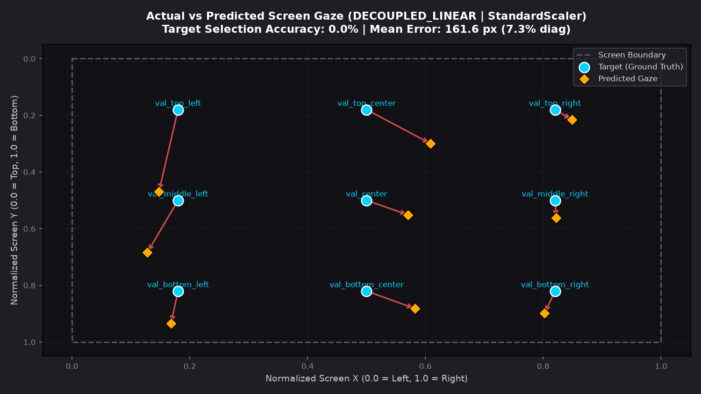
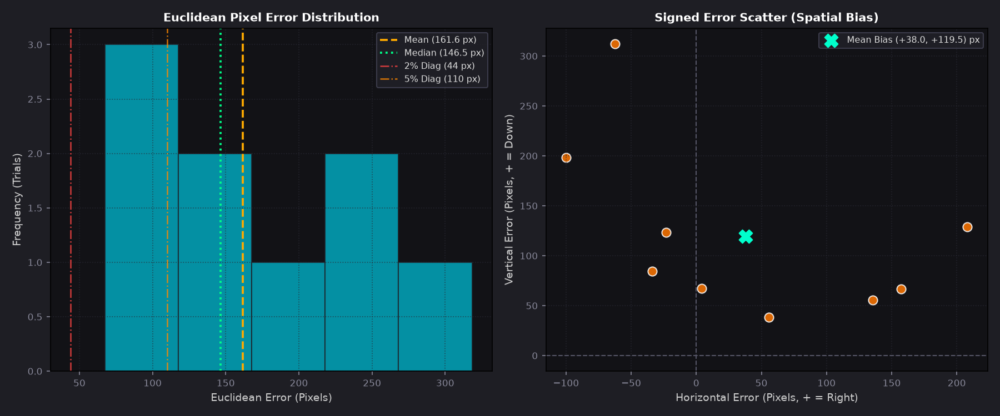
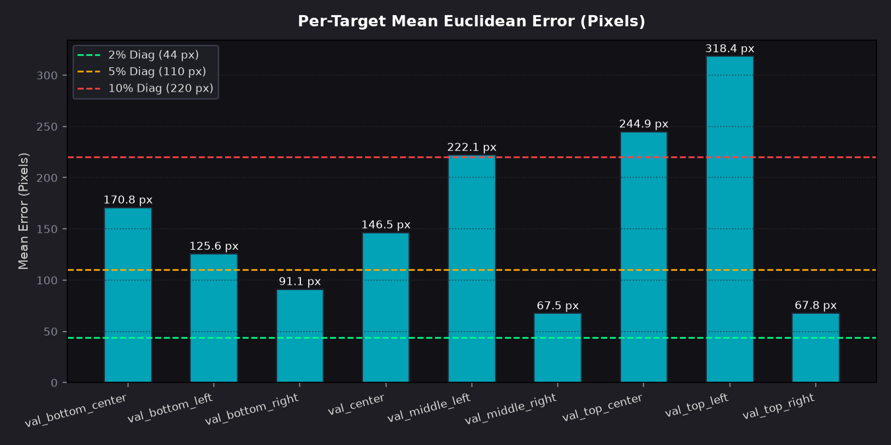

# Gaze Tracking Experiment Report: `experiment_20261125_184448`

## Experiment Overview

| Field | Value |
|---|---|
| **Experiment ID** | `experiment_20261125_184448` |
| **Date and Time** | 2026-11-25 18:45:26 |
| **Screen Resolution** | 1920x1080 (Diagonal: 2202.9 px) |
| **Calibration Model** | DECOUPLED_LINEAR |
| **Normalization Method** | StandardScaler |
| **Number of Training Samples** | 9 targets (259 accepted frames) |
| **Validation Status** | `COMPLETED` |
| **Number of Validation Trials** | 9 valid / 9 planned (0 rejected, 0.0% rej rate) |

## Main Results

> **Accuracy percentages** below measure how often gaze predictions landed successfully within strict screen tolerances or inside target boundaries (higher is better). **Average Error** measures distance from the true target (lower is better).

| Result | Value |
|---|---:|
| **Accuracy within 2%** | **0.0%** (0/9 trials, within 44.1 px) |
| **Accuracy within 5%** | **33.3%** (3/9 trials, within 110.1 px) |
| **Accuracy within 10%** | **66.7%** (6/9 trials, within 220.3 px) |
| **Target Selection Accuracy** | **0.0%** (0/9 hits) |
| **Average Error (pixels)** | 161.6 px |
| **Average Error (% of screen diagonal)** | 7.3% |
| **Rejected Trial Rate** | 0.0% (0/9) |

## Detailed Results

### Prediction Error Breakdown (Independent Validation Trials)

| Error Measurement | Pixels | Screen Diagonal / Normalized |
|---|---:|---:|
| **X-Axis MAE** | 86.7 px | 0.0451 norm |
| **Y-Axis MAE** | 119.5 px | 0.1106 norm |
| **X-Axis RMSE** | 108.1 px | 0.0563 norm |
| **Y-Axis RMSE** | 145.0 px | 0.1343 norm |
| **Median Error** | 146.5 px | 6.6% diag (0.1025 norm) |
| **Maximum Error** | 318.4 px | 14.5% diag (0.2909 norm) |
| **90th Percentile Error** | 259.6 px | — |

### Target Selection & Trial Counts

- **Target Boundary Evaluated:** Rendered Target Circle (radius 22 display px / 33.0 px @ 1920x1080)
- **Successful Selections (Hits):** 0
- **Failed Selections (Misses):** 9
- **Total Valid Trials:** 9
- **Rejected / Invalid Trials:** 0 (0.0%)

### Direction Accuracy Breakdown (LEFT / RIGHT / CENTER / UP / DOWN)

| Direction | Valid / Rej | Selection Accuracy | Within 5% | Mean Error (px) | Bias (X, Y) px |
|---|---:|---:|---:|---:|---:|
| `LEFT` | 3 / 0 | **0.0%** | 0.0% | 222.0 px | (-61.8, +211.3) |
| `RIGHT` | 3 / 0 | **0.0%** | 100.0% | 75.5 px | (+8.7, +63.4) |
| `CENTER` | 1 / 0 | **0.0%** | 0.0% | 146.5 px | (+135.6, +55.4) |
| `UP` | 3 / 0 | **0.0%** | 33.3% | 210.3 px | (+67.2, +159.8) |
| `DOWN` | 3 / 0 | **0.0%** | 33.3% | 129.1 px | (+33.5, +91.5) |

### Screen Region Accuracy Breakdown (Rows, Columns & Edges)

| Screen Region | Valid / Rej | Selection Accuracy | Within 5% | Mean Error (px) | Bias (X, Y) px |
|---|---:|---:|---:|---:|---:|
| `top_row` | 3 / 0 | **0.0%** | 33.3% | 210.3 px | (+67.2, +159.8) |
| `middle_row` | 3 / 0 | **0.0%** | 33.3% | 145.3 px | (+13.2, +107.0) |
| `bottom_row` | 3 / 0 | **0.0%** | 33.3% | 129.1 px | (+33.5, +91.5) |
| `left_column` | 3 / 0 | **0.0%** | 0.0% | 222.0 px | (-61.8, +211.3) |
| `center_column` | 3 / 0 | **0.0%** | 0.0% | 187.4 px | (+167.0, +83.6) |
| `right_column` | 3 / 0 | **0.0%** | 100.0% | 75.5 px | (+8.7, +63.4) |
| `edge_regions` | 8 / 0 | **0.0%** | 37.5% | 163.5 px | (+25.8, +127.5) |
| `center_region` | 1 / 0 | **0.0%** | 0.0% | 146.5 px | (+135.6, +55.4) |

### Per-Target Performance

| Target Point | Valid / Rejected | Hits / Valid | Target Selection Accuracy | Mean Error (px) | Bias (X, Y) px |
|---|---:|---:|---:|---:|---:|
| `val_bottom_center` | 1 / 0 | 0 / 1 | **0.0%** | 170.8 px | (+157.2, +66.5) |
| `val_bottom_left` | 1 / 0 | 0 / 1 | **0.0%** | 125.6 px | (-23.1, +123.4) |
| `val_bottom_right` | 1 / 0 | 0 / 1 | **0.0%** | 91.1 px | (-33.7, +84.6) |
| `val_center` | 1 / 0 | 0 / 1 | **0.0%** | 146.5 px | (+135.6, +55.4) |
| `val_middle_left` | 1 / 0 | 0 / 1 | **0.0%** | 222.1 px | (-99.9, +198.4) |
| `val_middle_right` | 1 / 0 | 0 / 1 | **0.0%** | 67.5 px | (+4.0, +67.3) |
| `val_top_center` | 1 / 0 | 0 / 1 | **0.0%** | 244.9 px | (+208.2, +128.9) |
| `val_top_left` | 1 / 0 | 0 / 1 | **0.0%** | 318.4 px | (-62.4, +312.2) |
| `val_top_right` | 1 / 0 | 0 / 1 | **0.0%** | 67.8 px | (+56.0, +38.3) |

### Training Performance vs. Independent Validation Performance

> **Note:** Training error only measures how tightly the model fits the 9 calibration points and must NOT be interpreted as real-world validation accuracy.

| Evaluation Split | Purpose | Mean Error (px) | Validation Accuracy |
|---|---|---:|---:|
| **Calibration Training Set** | Model fitting residual (training fit only) | 79.3 px | N/A (training split) |
| **Independent Validation Set** | Unseen test targets (real accuracy) | 161.6 px (7.3% diag) | 0.0% hits / 33.3% within 5% |

## Simple Explanation

Status: [COMPLETED]. The system successfully predicted gaze positions inside the target boundaries in 0 out of 9 valid trials (0.0%). Its average prediction error was 161.6 pixels (median: 146.5 px, 7.3% of the screen diagonal), and 33.3% of valid trials fell within 5% of the screen diagonal (3 out of 9). Weakest direction observed: LEFT (mean error 222.0 px); weakest screen region: left_column (mean error 222.0 px). This experiment performed better than the previous validated experiment (experiment_20261125_165544) according to the independent validation results (average error changed from 253.3 px to 161.6 px (36.2% error reduction); target selection accuracy changed from 0.0% to 0.0% (+0.0 percentage points)).

## Comparison with Previous Experiments

| Experiment ID | Model | Norm | Sel Acc | Within 2% | Within 5% | Within 10% | Mean Error | Median | Rej % | Weakest Dir / Region | Status |
| :--- | :---: | :---: | :---: | :---: | :---: | :---: | :---: | :---: | :---: | :--- | :--- |
| `experiment_20261123_221716` | **POLYNOMIAL** | None | N/A | N/A | N/A | N/A | N/A | N/A | N/A | -- | Calibrated Only (No Validation) |
| `experiment_20261123_224241` | **POLYNOMIAL** | None | N/A | N/A | N/A | N/A | N/A | N/A | N/A | -- | Calibrated Only (No Validation) |
| `experiment_20261124_220355` | **POLYNOMIAL** | StandardScaler | N/A | N/A | N/A | N/A | N/A | N/A | N/A | -- | Calibrated Only (No Validation) |
| `experiment_20261124_221738` | **POLYNOMIAL** | StandardScaler | N/A | N/A | N/A | N/A | N/A | N/A | N/A | -- | Calibrated Only (No Validation) |
| `experiment_20261124_225435` | **LINEAR** | StandardScaler | N/A | N/A | N/A | N/A | N/A | N/A | N/A | -- | Calibrated Only (No Validation) |
| `experiment_20261124_225544` | **COMPACT_POLYNOMIAL** | StandardScaler | N/A | N/A | N/A | N/A | N/A | N/A | N/A | -- | Calibrated Only (No Validation) |
| `experiment_20261124_232039` | **LINEAR** | StandardScaler | 0.0% | 0.0% | 0.0% | 33.3% | **423.4 px** | 301.0 px | 0.0% | LEFT / left_column | Validated |
| `experiment_20261124_232710` | **LINEAR** | StandardScaler | 0.0% | 0.0% | 0.0% | 33.3% | **314.8 px** | 319.3 px | 0.0% | UP / top_row | Validated |
| `experiment_20261125_141825` | **COMPACT_LINEAR** | StandardScaler | 0.0% | 0.0% | 0.0% | 33.3% | **312.0 px** | 274.1 px | 0.0% | RIGHT / right_column | Validated |
| `experiment_20261125_142358` | **LINEAR** | StandardScaler | 0.0% | 11.1% | 22.2% | 55.6% | **215.9 px** | 216.3 px | 0.0% | DOWN / bottom_row | Validated |
| `experiment_20261125_150006` | **LINEAR** | StandardScaler | 0.0% | 0.0% | 0.0% | 66.7% | **177.0 px** | 163.5 px | 0.0% | LEFT / left_column | Validated |
| `experiment_20261125_150223` | **DECOUPLED_POLYNOMIAL** | StandardScaler | 11.1% | 11.1% | 77.8% | 100.0% | **95.4 px** | 97.3 px | 0.0% | RIGHT / right_column | Validated |
| `experiment_20261125_153718` | **LINEAR** | StandardScaler | 0.0% | 11.1% | 77.8% | 100.0% | **87.8 px** | 83.2 px | 0.0% | LEFT / left_column | Validated |
| `experiment_20261125_162637` | **COMPACT_POLYNOMIAL** | StandardScaler | 0.0% | 0.0% | 22.2% | 77.8% | **175.3 px** | 173.2 px | 0.0% | CENTER / center_column | Validated |
| `experiment_20261125_162740` | **LINEAR** | StandardScaler | 0.0% | 0.0% | 0.0% | 55.6% | **202.9 px** | 197.1 px | 0.0% | UP / top_row | Validated |
| `experiment_20261125_165544` | **COMPACT_LINEAR** | StandardScaler | 0.0% | 0.0% | 22.2% | 44.4% | **253.3 px** | 229.0 px | 0.0% | UP / top_row | Validated |
| `experiment_20261125_184448` | **DECOUPLED_LINEAR** | StandardScaler | 0.0% | 0.0% | 33.3% | 66.7% | **161.6 px** | 146.5 px | 0.0% | LEFT / left_column | Validated |

- **Compatibility Warning:** Target button/circle boundaries differ across validated runs.
- **Best Validated Experiment:** `experiment_20261125_150223` (11.1% target selection, 95.4 px mean error) (weakest dir: RIGHT, weakest region: right_column).
- **Lowest Mean Pixel Error:** `experiment_20261125_153718` (87.8 px).
- **Latest vs. Previous Validated (`experiment_20261125_184448` vs `experiment_20261125_165544`):** **IMPROVED** (Mean Error -91.7 px (36.2% error reduction); Target Selection Accuracy +0.0 percentage points; Within 5% Accuracy +11.1 percentage points).

## Diagnostic Plots

