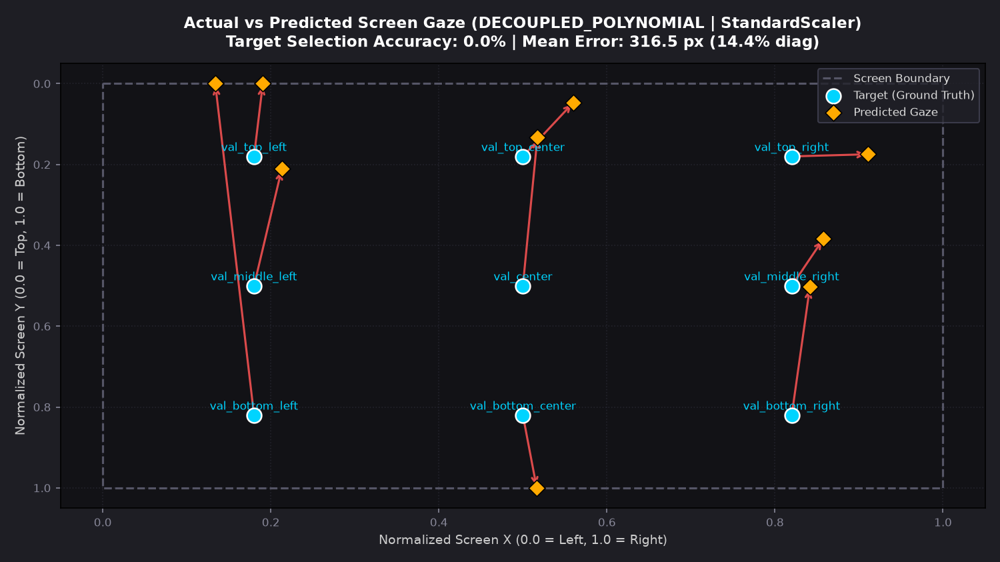
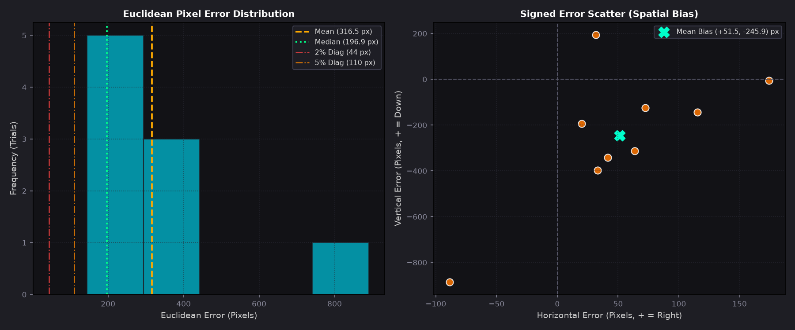
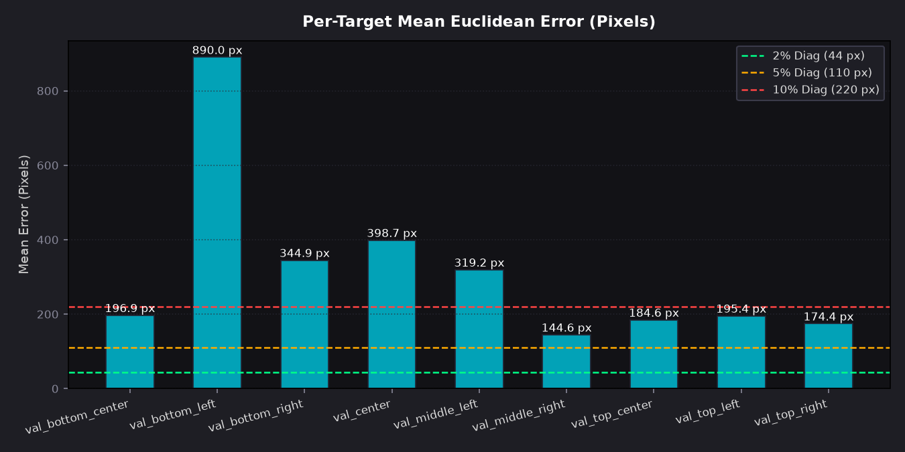

# Gaze Tracking Experiment Report: `experiment_20261125_184929`

## Experiment Overview

| Field | Value |
|---|---|
| **Experiment ID** | `experiment_20261125_184929` |
| **Date and Time** | 2026-11-25 18:50:10 |
| **Screen Resolution** | 1920x1080 (Diagonal: 2202.9 px) |
| **Calibration Model** | DECOUPLED_POLYNOMIAL |
| **Normalization Method** | StandardScaler |
| **Number of Training Samples** | 9 targets (281 accepted frames) |
| **Validation Status** | `COMPLETED` |
| **Number of Validation Trials** | 9 valid / 9 planned (0 rejected, 0.0% rej rate) |

## Main Results

> **Accuracy percentages** below measure how often gaze predictions landed successfully within strict screen tolerances or inside target boundaries (higher is better). **Average Error** measures distance from the true target (lower is better).

| Result | Value |
|---|---:|
| **Accuracy within 2%** | **0.0%** (0/9 trials, within 44.1 px) |
| **Accuracy within 5%** | **0.0%** (0/9 trials, within 110.1 px) |
| **Accuracy within 10%** | **55.6%** (5/9 trials, within 220.3 px) |
| **Target Selection Accuracy** | **0.0%** (0/9 hits) |
| **Average Error (pixels)** | 316.5 px |
| **Average Error (% of screen diagonal)** | 14.4% |
| **Rejected Trial Rate** | 0.0% (0/9) |

## Detailed Results

### Prediction Error Breakdown (Independent Validation Trials)

| Error Measurement | Pixels | Screen Diagonal / Normalized |
|---|---:|---:|
| **X-Axis MAE** | 71.2 px | 0.0371 norm |
| **Y-Axis MAE** | 289.1 px | 0.2677 norm |
| **X-Axis RMSE** | 85.0 px | 0.0443 norm |
| **Y-Axis RMSE** | 375.5 px | 0.3477 norm |
| **Median Error** | 196.9 px | 8.9% diag (0.1807 norm) |
| **Maximum Error** | 890.0 px | 40.4% diag (0.8213 norm) |
| **90th Percentile Error** | 496.9 px | — |

### Target Selection & Trial Counts

- **Target Boundary Evaluated:** Rendered Target Circle (radius 22 display px / 33.0 px @ 1920x1080)
- **Successful Selections (Hits):** 0
- **Failed Selections (Misses):** 9
- **Total Valid Trials:** 9
- **Rejected / Invalid Trials:** 0 (0.0%)

### Direction Accuracy Breakdown (LEFT / RIGHT / CENTER / UP / DOWN)

| Direction | Valid / Rej | Selection Accuracy | Within 5% | Mean Error (px) | Bias (X, Y) px |
|---|---:|---:|---:|---:|---:|
| `LEFT` | 3 / 0 | **0.0%** | 0.0% | 468.2 px | (-1.7, -464.3) |
| `RIGHT` | 3 / 0 | **0.0%** | 0.0% | 221.3 px | (+96.0, -157.8) |
| `CENTER` | 1 / 0 | **0.0%** | 0.0% | 398.7 px | (+33.2, -397.3) |
| `UP` | 3 / 0 | **0.0%** | 0.0% | 184.8 px | (+103.3, -114.7) |
| `DOWN` | 3 / 0 | **0.0%** | 0.0% | 477.3 px | (-5.2, -344.6) |

### Screen Region Accuracy Breakdown (Rows, Columns & Edges)

| Screen Region | Valid / Rej | Selection Accuracy | Within 5% | Mean Error (px) | Bias (X, Y) px |
|---|---:|---:|---:|---:|---:|
| `top_row` | 3 / 0 | **0.0%** | 0.0% | 184.8 px | (+103.3, -114.7) |
| `middle_row` | 3 / 0 | **0.0%** | 0.0% | 287.5 px | (+56.3, -278.4) |
| `bottom_row` | 3 / 0 | **0.0%** | 0.0% | 477.3 px | (-5.2, -344.6) |
| `left_column` | 3 / 0 | **0.0%** | 0.0% | 468.2 px | (-1.7, -464.3) |
| `center_column` | 3 / 0 | **0.0%** | 0.0% | 260.1 px | (+60.1, -115.7) |
| `right_column` | 3 / 0 | **0.0%** | 0.0% | 221.3 px | (+96.0, -157.8) |
| `edge_regions` | 8 / 0 | **0.0%** | 0.0% | 306.3 px | (+53.7, -227.0) |
| `center_region` | 1 / 0 | **0.0%** | 0.0% | 398.7 px | (+33.2, -397.3) |

### Per-Target Performance

| Target Point | Valid / Rejected | Hits / Valid | Target Selection Accuracy | Mean Error (px) | Bias (X, Y) px |
|---|---:|---:|---:|---:|---:|
| `val_bottom_center` | 1 / 0 | 0 / 1 | **0.0%** | 196.9 px | (+31.6, +194.4) |
| `val_bottom_left` | 1 / 0 | 0 / 1 | **0.0%** | 890.0 px | (-88.7, -885.6) |
| `val_bottom_right` | 1 / 0 | 0 / 1 | **0.0%** | 344.9 px | (+41.5, -342.4) |
| `val_center` | 1 / 0 | 0 / 1 | **0.0%** | 398.7 px | (+33.2, -397.3) |
| `val_middle_left` | 1 / 0 | 0 / 1 | **0.0%** | 319.2 px | (+63.5, -312.8) |
| `val_middle_right` | 1 / 0 | 0 / 1 | **0.0%** | 144.6 px | (+72.2, -125.2) |
| `val_top_center` | 1 / 0 | 0 / 1 | **0.0%** | 184.6 px | (+115.4, -144.1) |
| `val_top_left` | 1 / 0 | 0 / 1 | **0.0%** | 195.4 px | (+20.1, -194.4) |
| `val_top_right` | 1 / 0 | 0 / 1 | **0.0%** | 174.4 px | (+174.3, -5.7) |

### Training Performance vs. Independent Validation Performance

> **Note:** Training error only measures how tightly the model fits the 9 calibration points and must NOT be interpreted as real-world validation accuracy.

| Evaluation Split | Purpose | Mean Error (px) | Validation Accuracy |
|---|---|---:|---:|
| **Calibration Training Set** | Model fitting residual (training fit only) | 81.5 px | N/A (training split) |
| **Independent Validation Set** | Unseen test targets (real accuracy) | 316.5 px (14.4% diag) | 0.0% hits / 0.0% within 5% |

## Simple Explanation

Status: [COMPLETED]. The system successfully predicted gaze positions inside the target boundaries in 0 out of 9 valid trials (0.0%). Its average prediction error was 316.5 pixels (median: 196.9 px, 14.4% of the screen diagonal), and 0.0% of valid trials fell within 5% of the screen diagonal (0 out of 9). Weakest direction observed: DOWN (mean error 477.3 px); weakest screen region: bottom_row (mean error 477.3 px). This experiment performed worse than the previous validated experiment (experiment_20261125_184448) according to the independent validation results (average error changed from 161.6 px to 316.5 px (95.9% error increase); target selection accuracy changed from 0.0% to 0.0% (+0.0 percentage points)).

## Comparison with Previous Experiments

| Experiment ID | Model | Norm | Sel Acc | Within 2% | Within 5% | Within 10% | Mean Error | Median | Rej % | Weakest Dir / Region | Status |
| :--- | :---: | :---: | :---: | :---: | :---: | :---: | :---: | :---: | :---: | :--- | :--- |
| `experiment_20261123_221716` | **POLYNOMIAL** | None | N/A | N/A | N/A | N/A | N/A | N/A | N/A | -- | Calibrated Only (No Validation) |
| `experiment_20261123_224241` | **POLYNOMIAL** | None | N/A | N/A | N/A | N/A | N/A | N/A | N/A | -- | Calibrated Only (No Validation) |
| `experiment_20261124_220355` | **POLYNOMIAL** | StandardScaler | N/A | N/A | N/A | N/A | N/A | N/A | N/A | -- | Calibrated Only (No Validation) |
| `experiment_20261124_221738` | **POLYNOMIAL** | StandardScaler | N/A | N/A | N/A | N/A | N/A | N/A | N/A | -- | Calibrated Only (No Validation) |
| `experiment_20261124_225435` | **LINEAR** | StandardScaler | N/A | N/A | N/A | N/A | N/A | N/A | N/A | -- | Calibrated Only (No Validation) |
| `experiment_20261124_225544` | **COMPACT_POLYNOMIAL** | StandardScaler | N/A | N/A | N/A | N/A | N/A | N/A | N/A | -- | Calibrated Only (No Validation) |
| `experiment_20261124_232039` | **LINEAR** | StandardScaler | 0.0% | 0.0% | 0.0% | 33.3% | **423.4 px** | 301.0 px | 0.0% | LEFT / left_column | Validated |
| `experiment_20261124_232710` | **LINEAR** | StandardScaler | 0.0% | 0.0% | 0.0% | 33.3% | **314.8 px** | 319.3 px | 0.0% | UP / top_row | Validated |
| `experiment_20261125_141825` | **COMPACT_LINEAR** | StandardScaler | 0.0% | 0.0% | 0.0% | 33.3% | **312.0 px** | 274.1 px | 0.0% | RIGHT / right_column | Validated |
| `experiment_20261125_142358` | **LINEAR** | StandardScaler | 0.0% | 11.1% | 22.2% | 55.6% | **215.9 px** | 216.3 px | 0.0% | DOWN / bottom_row | Validated |
| `experiment_20261125_150006` | **LINEAR** | StandardScaler | 0.0% | 0.0% | 0.0% | 66.7% | **177.0 px** | 163.5 px | 0.0% | LEFT / left_column | Validated |
| `experiment_20261125_150223` | **DECOUPLED_POLYNOMIAL** | StandardScaler | 11.1% | 11.1% | 77.8% | 100.0% | **95.4 px** | 97.3 px | 0.0% | RIGHT / right_column | Validated |
| `experiment_20261125_153718` | **LINEAR** | StandardScaler | 0.0% | 11.1% | 77.8% | 100.0% | **87.8 px** | 83.2 px | 0.0% | LEFT / left_column | Validated |
| `experiment_20261125_162637` | **COMPACT_POLYNOMIAL** | StandardScaler | 0.0% | 0.0% | 22.2% | 77.8% | **175.3 px** | 173.2 px | 0.0% | CENTER / center_column | Validated |
| `experiment_20261125_162740` | **LINEAR** | StandardScaler | 0.0% | 0.0% | 0.0% | 55.6% | **202.9 px** | 197.1 px | 0.0% | UP / top_row | Validated |
| `experiment_20261125_165544` | **COMPACT_LINEAR** | StandardScaler | 0.0% | 0.0% | 22.2% | 44.4% | **253.3 px** | 229.0 px | 0.0% | UP / top_row | Validated |
| `experiment_20261125_184448` | **DECOUPLED_LINEAR** | StandardScaler | 0.0% | 0.0% | 33.3% | 66.7% | **161.6 px** | 146.5 px | 0.0% | LEFT / left_column | Validated |
| `experiment_20261125_184929` | **DECOUPLED_POLYNOMIAL** | StandardScaler | 0.0% | 0.0% | 0.0% | 55.6% | **316.5 px** | 196.9 px | 0.0% | DOWN / bottom_row | Validated |

- **Compatibility Warning:** Target button/circle boundaries differ across validated runs.
- **Best Validated Experiment:** `experiment_20261125_150223` (11.1% target selection, 95.4 px mean error) (weakest dir: RIGHT, weakest region: right_column).
- **Lowest Mean Pixel Error:** `experiment_20261125_153718` (87.8 px).
- **Latest vs. Previous Validated (`experiment_20261125_184929` vs `experiment_20261125_184448`):** **GOT WORSE** (Mean Error +154.9 px (95.9% error increase); Target Selection Accuracy +0.0 percentage points; Within 5% Accuracy -33.3 percentage points).

## Diagnostic Plots

