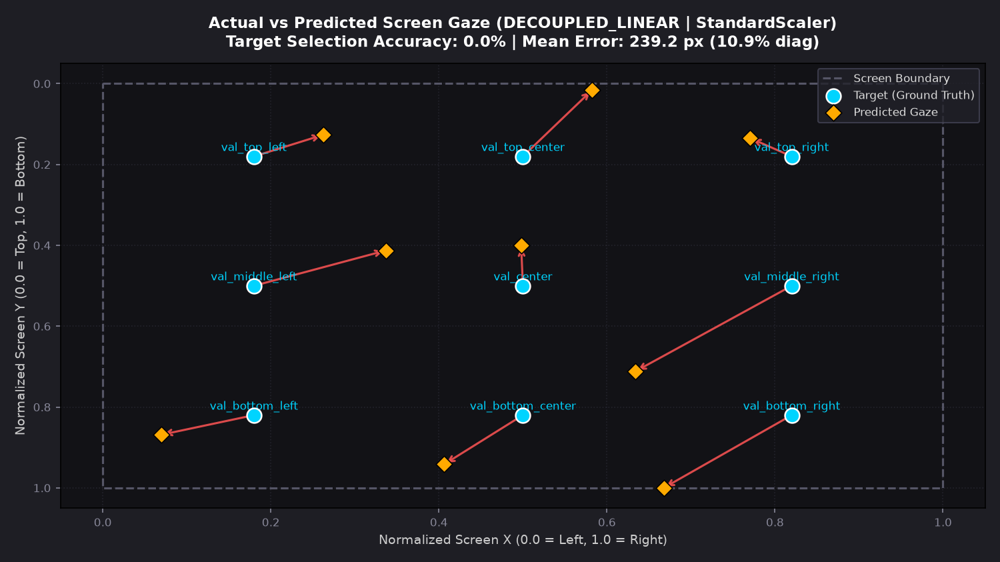
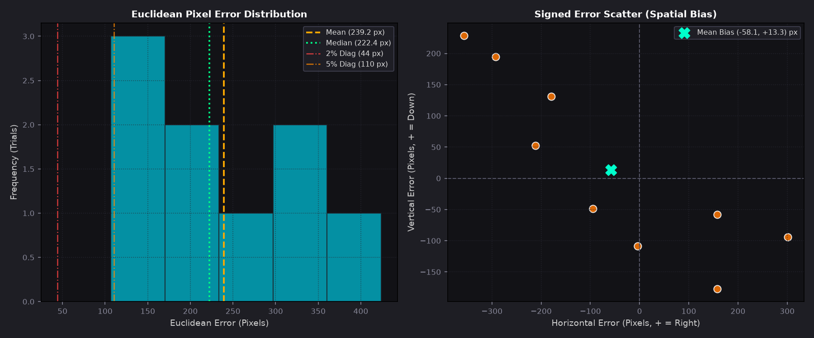
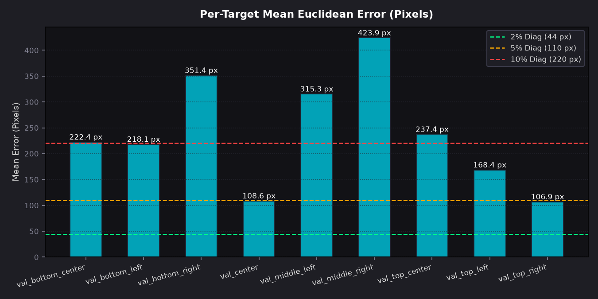

# Gaze Tracking Experiment Report: `experiment_20261125_185024`

## Experiment Overview

| Field | Value |
|---|---|
| **Experiment ID** | `experiment_20261125_185024` |
| **Date and Time** | 2026-11-25 18:51:07 |
| **Screen Resolution** | 1920x1080 (Diagonal: 2202.9 px) |
| **Calibration Model** | DECOUPLED_LINEAR |
| **Normalization Method** | StandardScaler |
| **Number of Training Samples** | 9 targets (186 accepted frames) |
| **Validation Status** | `COMPLETED` |
| **Number of Validation Trials** | 9 valid / 9 planned (0 rejected, 0.0% rej rate) |

## Main Results

> **Accuracy percentages** below measure how often gaze predictions landed successfully within strict screen tolerances or inside target boundaries (higher is better). **Average Error** measures distance from the true target (lower is better).

| Result | Value |
|---|---:|
| **Accuracy within 2%** | **0.0%** (0/9 trials, within 44.1 px) |
| **Accuracy within 5%** | **22.2%** (2/9 trials, within 110.1 px) |
| **Accuracy within 10%** | **44.4%** (4/9 trials, within 220.3 px) |
| **Target Selection Accuracy** | **0.0%** (0/9 hits) |
| **Average Error (pixels)** | 239.2 px |
| **Average Error (% of screen diagonal)** | 10.9% |
| **Rejected Trial Rate** | 0.0% (0/9) |

## Detailed Results

### Prediction Error Breakdown (Independent Validation Trials)

| Error Measurement | Pixels | Screen Diagonal / Normalized |
|---|---:|---:|
| **X-Axis MAE** | 195.3 px | 0.1017 norm |
| **Y-Axis MAE** | 121.4 px | 0.1124 norm |
| **X-Axis RMSE** | 221.1 px | 0.1151 norm |
| **Y-Axis RMSE** | 136.5 px | 0.1264 norm |
| **Median Error** | 222.4 px | 10.1% diag (0.1533 norm) |
| **Maximum Error** | 423.9 px | 19.2% diag (0.2817 norm) |
| **90th Percentile Error** | 365.9 px | — |

### Target Selection & Trial Counts

- **Target Boundary Evaluated:** Rendered Target Circle (radius 22 display px / 33.0 px @ 1920x1080)
- **Successful Selections (Hits):** 0
- **Failed Selections (Misses):** 9
- **Total Valid Trials:** 9
- **Rejected / Invalid Trials:** 0 (0.0%)

### Direction Accuracy Breakdown (LEFT / RIGHT / CENTER / UP / DOWN)

| Direction | Valid / Rej | Selection Accuracy | Within 5% | Mean Error (px) | Bias (X, Y) px |
|---|---:|---:|---:|---:|---:|
| `LEFT` | 3 / 0 | **0.0%** | 0.0% | 234.0 px | (+82.5, -33.2) |
| `RIGHT` | 3 / 0 | **0.0%** | 33.3% | 294.1 px | (-248.3, +124.7) |
| `CENTER` | 1 / 0 | **0.0%** | 100.0% | 108.6 px | (-4.0, -108.5) |
| `UP` | 3 / 0 | **0.0%** | 33.3% | 170.9 px | (+73.7, -94.6) |
| `DOWN` | 3 / 0 | **0.0%** | 0.0% | 264.0 px | (-228.0, +126.0) |

### Screen Region Accuracy Breakdown (Rows, Columns & Edges)

| Screen Region | Valid / Rej | Selection Accuracy | Within 5% | Mean Error (px) | Bias (X, Y) px |
|---|---:|---:|---:|---:|---:|
| `top_row` | 3 / 0 | **0.0%** | 33.3% | 170.9 px | (+73.7, -94.6) |
| `middle_row` | 3 / 0 | **0.0%** | 33.3% | 282.6 px | (-20.1, +8.6) |
| `bottom_row` | 3 / 0 | **0.0%** | 0.0% | 264.0 px | (-228.0, +126.0) |
| `left_column` | 3 / 0 | **0.0%** | 0.0% | 234.0 px | (+82.5, -33.2) |
| `center_column` | 3 / 0 | **0.0%** | 33.3% | 189.5 px | (-8.6, -51.5) |
| `right_column` | 3 / 0 | **0.0%** | 33.3% | 294.1 px | (-248.3, +124.7) |
| `edge_regions` | 8 / 0 | **0.0%** | 12.5% | 255.5 px | (-64.9, +28.6) |
| `center_region` | 1 / 0 | **0.0%** | 100.0% | 108.6 px | (-4.0, -108.5) |

### Per-Target Performance

| Target Point | Valid / Rejected | Hits / Valid | Target Selection Accuracy | Mean Error (px) | Bias (X, Y) px |
|---|---:|---:|---:|---:|---:|
| `val_bottom_center` | 1 / 0 | 0 / 1 | **0.0%** | 222.4 px | (-179.7, +131.1) |
| `val_bottom_left` | 1 / 0 | 0 / 1 | **0.0%** | 218.1 px | (-211.7, +52.4) |
| `val_bottom_right` | 1 / 0 | 0 / 1 | **0.0%** | 351.4 px | (-292.7, +194.4) |
| `val_center` | 1 / 0 | 0 / 1 | **0.0%** | 108.6 px | (-4.0, -108.5) |
| `val_middle_left` | 1 / 0 | 0 / 1 | **0.0%** | 315.3 px | (+300.9, -94.2) |
| `val_middle_right` | 1 / 0 | 0 / 1 | **0.0%** | 423.9 px | (-357.1, +228.4) |
| `val_top_center` | 1 / 0 | 0 / 1 | **0.0%** | 237.4 px | (+158.0, -177.2) |
| `val_top_left` | 1 / 0 | 0 / 1 | **0.0%** | 168.4 px | (+158.2, -57.8) |
| `val_top_right` | 1 / 0 | 0 / 1 | **0.0%** | 106.9 px | (-95.2, -48.8) |

### Training Performance vs. Independent Validation Performance

> **Note:** Training error only measures how tightly the model fits the 9 calibration points and must NOT be interpreted as real-world validation accuracy.

| Evaluation Split | Purpose | Mean Error (px) | Validation Accuracy |
|---|---|---:|---:|
| **Calibration Training Set** | Model fitting residual (training fit only) | 116.1 px | N/A (training split) |
| **Independent Validation Set** | Unseen test targets (real accuracy) | 239.2 px (10.9% diag) | 0.0% hits / 22.2% within 5% |

## Simple Explanation

Status: [COMPLETED]. The system successfully predicted gaze positions inside the target boundaries in 0 out of 9 valid trials (0.0%). Its average prediction error was 239.2 pixels (median: 222.4 px, 10.9% of the screen diagonal), and 22.2% of valid trials fell within 5% of the screen diagonal (2 out of 9). Weakest direction observed: RIGHT (mean error 294.1 px); weakest screen region: right_column (mean error 294.1 px). This experiment performed better than the previous validated experiment (experiment_20261125_184929) according to the independent validation results (average error changed from 316.5 px to 239.2 px (24.4% error reduction); target selection accuracy changed from 0.0% to 0.0% (+0.0 percentage points)).

## Comparison with Previous Experiments

| Experiment ID | Model | Norm | Sel Acc | Within 2% | Within 5% | Within 10% | Mean Error | Median | Rej % | Weakest Dir / Region | Status |
| :--- | :---: | :---: | :---: | :---: | :---: | :---: | :---: | :---: | :---: | :--- | :--- |
| `experiment_20261123_221716` | **POLYNOMIAL** | None | N/A | N/A | N/A | N/A | N/A | N/A | N/A | -- | Calibrated Only (No Validation) |
| `experiment_20261123_224241` | **POLYNOMIAL** | None | N/A | N/A | N/A | N/A | N/A | N/A | N/A | -- | Calibrated Only (No Validation) |
| `experiment_20261124_220355` | **POLYNOMIAL** | StandardScaler | N/A | N/A | N/A | N/A | N/A | N/A | N/A | -- | Calibrated Only (No Validation) |
| `experiment_20261124_221738` | **POLYNOMIAL** | StandardScaler | N/A | N/A | N/A | N/A | N/A | N/A | N/A | -- | Calibrated Only (No Validation) |
| `experiment_20261124_225435` | **LINEAR** | StandardScaler | N/A | N/A | N/A | N/A | N/A | N/A | N/A | -- | Calibrated Only (No Validation) |
| `experiment_20261124_225544` | **COMPACT_POLYNOMIAL** | StandardScaler | N/A | N/A | N/A | N/A | N/A | N/A | N/A | -- | Calibrated Only (No Validation) |
| `experiment_20261124_232039` | **LINEAR** | StandardScaler | 0.0% | 0.0% | 0.0% | 33.3% | **423.4 px** | 301.0 px | 0.0% | LEFT / left_column | Validated |
| `experiment_20261124_232710` | **LINEAR** | StandardScaler | 0.0% | 0.0% | 0.0% | 33.3% | **314.8 px** | 319.3 px | 0.0% | UP / top_row | Validated |
| `experiment_20261125_141825` | **COMPACT_LINEAR** | StandardScaler | 0.0% | 0.0% | 0.0% | 33.3% | **312.0 px** | 274.1 px | 0.0% | RIGHT / right_column | Validated |
| `experiment_20261125_142358` | **LINEAR** | StandardScaler | 0.0% | 11.1% | 22.2% | 55.6% | **215.9 px** | 216.3 px | 0.0% | DOWN / bottom_row | Validated |
| `experiment_20261125_150006` | **LINEAR** | StandardScaler | 0.0% | 0.0% | 0.0% | 66.7% | **177.0 px** | 163.5 px | 0.0% | LEFT / left_column | Validated |
| `experiment_20261125_150223` | **DECOUPLED_POLYNOMIAL** | StandardScaler | 11.1% | 11.1% | 77.8% | 100.0% | **95.4 px** | 97.3 px | 0.0% | RIGHT / right_column | Validated |
| `experiment_20261125_153718` | **LINEAR** | StandardScaler | 0.0% | 11.1% | 77.8% | 100.0% | **87.8 px** | 83.2 px | 0.0% | LEFT / left_column | Validated |
| `experiment_20261125_162637` | **COMPACT_POLYNOMIAL** | StandardScaler | 0.0% | 0.0% | 22.2% | 77.8% | **175.3 px** | 173.2 px | 0.0% | CENTER / center_column | Validated |
| `experiment_20261125_162740` | **LINEAR** | StandardScaler | 0.0% | 0.0% | 0.0% | 55.6% | **202.9 px** | 197.1 px | 0.0% | UP / top_row | Validated |
| `experiment_20261125_165544` | **COMPACT_LINEAR** | StandardScaler | 0.0% | 0.0% | 22.2% | 44.4% | **253.3 px** | 229.0 px | 0.0% | UP / top_row | Validated |
| `experiment_20261125_184448` | **DECOUPLED_LINEAR** | StandardScaler | 0.0% | 0.0% | 33.3% | 66.7% | **161.6 px** | 146.5 px | 0.0% | LEFT / left_column | Validated |
| `experiment_20261125_184929` | **DECOUPLED_POLYNOMIAL** | StandardScaler | 0.0% | 0.0% | 0.0% | 55.6% | **316.5 px** | 196.9 px | 0.0% | DOWN / bottom_row | Validated |
| `experiment_20261125_185024` | **DECOUPLED_LINEAR** | StandardScaler | 0.0% | 0.0% | 22.2% | 44.4% | **239.2 px** | 222.4 px | 0.0% | RIGHT / right_column | Validated |

- **Compatibility Warning:** Target button/circle boundaries differ across validated runs.
- **Best Validated Experiment:** `experiment_20261125_150223` (11.1% target selection, 95.4 px mean error) (weakest dir: RIGHT, weakest region: right_column).
- **Lowest Mean Pixel Error:** `experiment_20261125_153718` (87.8 px).
- **Latest vs. Previous Validated (`experiment_20261125_185024` vs `experiment_20261125_184929`):** **IMPROVED** (Mean Error -77.4 px (24.4% error reduction); Target Selection Accuracy +0.0 percentage points; Within 5% Accuracy +22.2 percentage points).

## Diagnostic Plots

