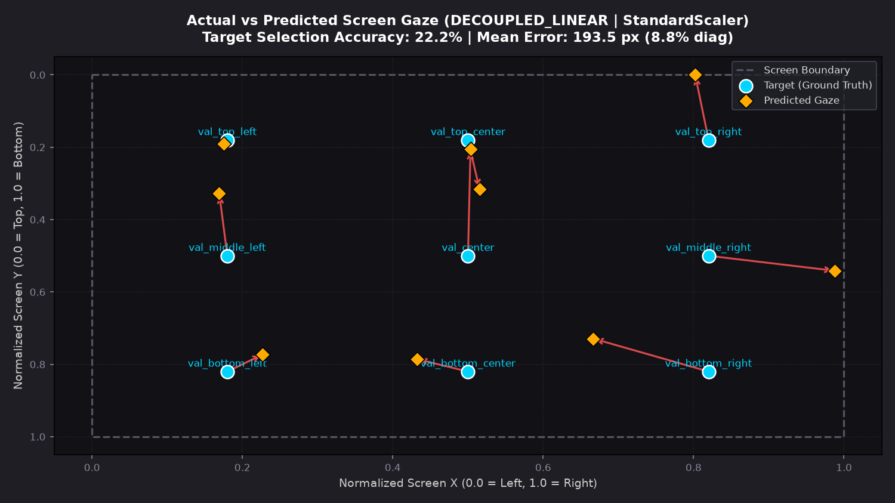
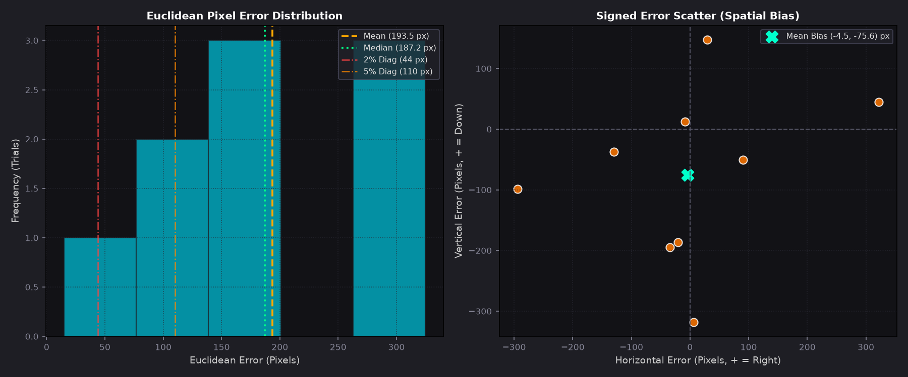
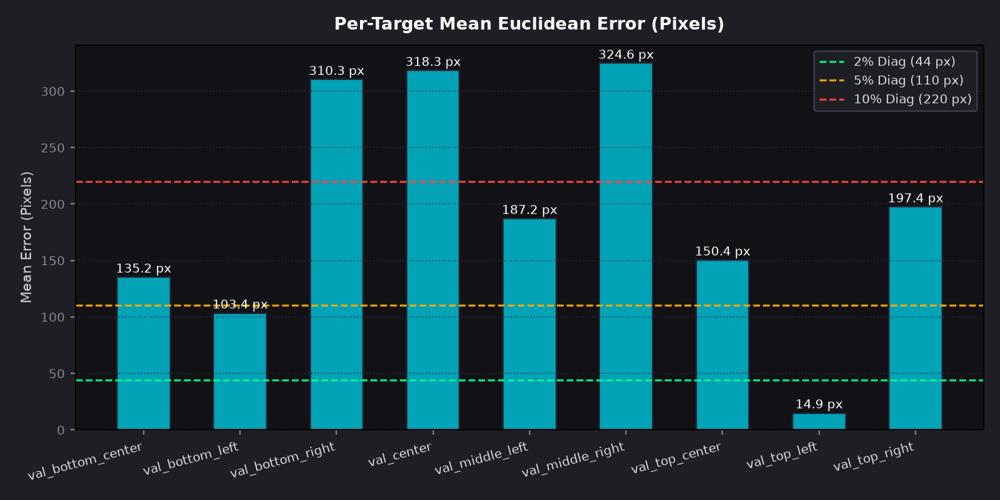

# Gaze Tracking Experiment Report: `experiment_20261126_121528`

## Experiment Overview

| Field | Value |
|---|---|
| **Experiment ID** | `experiment_20261126_121528` |
| **Date and Time** | 2026-11-26 12:16:07 |
| **Screen Resolution** | 1920x1080 (Diagonal: 2202.9 px) |
| **Calibration Model** | DECOUPLED_LINEAR |
| **Normalization Method** | StandardScaler |
| **Number of Training Samples** | 9 targets (243 accepted frames) |
| **Validation Status** | `COMPLETED` |
| **Number of Validation Trials** | 9 valid / 9 planned (0 rejected, 0.0% rej rate) |

## Main Results

> **Accuracy percentages** below measure how often gaze predictions landed successfully within strict screen tolerances or inside target boundaries (higher is better). **Average Error** measures distance from the true target (lower is better).

| Result | Value |
|---|---:|
| **Accuracy within 2%** | **11.1%** (1/9 trials, within 44.1 px) |
| **Accuracy within 5%** | **22.2%** (2/9 trials, within 110.1 px) |
| **Accuracy within 10%** | **66.7%** (6/9 trials, within 220.3 px) |
| **Target Selection Accuracy** | **22.2%** (2/9 hits) |
| **Average Error (pixels)** | 193.5 px |
| **Average Error (% of screen diagonal)** | 8.8% |
| **Rejected Trial Rate** | 0.0% (0/9) |

## Detailed Results

### Prediction Error Breakdown (Independent Validation Trials)

| Error Measurement | Pixels | Screen Diagonal / Normalized |
|---|---:|---:|
| **X-Axis MAE** | 104.0 px | 0.0542 norm |
| **Y-Axis MAE** | 121.0 px | 0.1120 norm |
| **X-Axis RMSE** | 155.5 px | 0.0810 norm |
| **Y-Axis RMSE** | 153.2 px | 0.1418 norm |
| **Median Error** | 187.2 px | 8.5% diag (0.1725 norm) |
| **Maximum Error** | 324.6 px | 14.7% diag (0.2947 norm) |
| **90th Percentile Error** | 319.5 px | — |

### Target Selection & Trial Counts

- **Target Boundary Evaluated:** Button Box (200x150 px)
- **Successful Selections (Hits):** 2
- **Failed Selections (Misses):** 7
- **Total Valid Trials:** 9
- **Rejected / Invalid Trials:** 0 (0.0%)

### Direction Accuracy Breakdown (LEFT / RIGHT / CENTER / UP / DOWN)

| Direction | Valid / Rej | Selection Accuracy | Within 5% | Mean Error (px) | Bias (X, Y) px |
|---|---:|---:|---:|---:|---:|
| `LEFT` | 3 / 0 | **66.7%** | 66.7% | 101.8 px | (+20.2, -74.9) |
| `RIGHT` | 3 / 0 | **0.0%** | 0.0% | 277.4 px | (-2.4, -82.7) |
| `CENTER` | 1 / 0 | **0.0%** | 0.0% | 318.3 px | (+6.4, -318.2) |
| `UP` | 3 / 0 | **33.3%** | 33.3% | 120.9 px | (-4.5, -11.6) |
| `DOWN` | 3 / 0 | **33.3%** | 33.3% | 183.0 px | (-111.5, -62.0) |

### Screen Region Accuracy Breakdown (Rows, Columns & Edges)

| Screen Region | Valid / Rej | Selection Accuracy | Within 5% | Mean Error (px) | Bias (X, Y) px |
|---|---:|---:|---:|---:|---:|
| `top_row` | 3 / 0 | **33.3%** | 33.3% | 120.9 px | (-4.5, -11.6) |
| `middle_row` | 3 / 0 | **0.0%** | 0.0% | 276.7 px | (+102.4, -153.2) |
| `bottom_row` | 3 / 0 | **33.3%** | 33.3% | 183.0 px | (-111.5, -62.0) |
| `left_column` | 3 / 0 | **66.7%** | 66.7% | 101.8 px | (+20.2, -74.9) |
| `center_column` | 3 / 0 | **0.0%** | 0.0% | 201.3 px | (-31.3, -69.3) |
| `right_column` | 3 / 0 | **0.0%** | 0.0% | 277.4 px | (-2.4, -82.7) |
| `edge_regions` | 8 / 0 | **25.0%** | 25.0% | 177.9 px | (-5.9, -45.3) |
| `center_region` | 1 / 0 | **0.0%** | 0.0% | 318.3 px | (+6.4, -318.2) |

### Per-Target Performance

| Target Point | Valid / Rejected | Hits / Valid | Target Selection Accuracy | Mean Error (px) | Bias (X, Y) px |
|---|---:|---:|---:|---:|---:|
| `val_bottom_center` | 1 / 0 | 0 / 1 | **0.0%** | 135.2 px | (-130.1, -37.0) |
| `val_bottom_left` | 1 / 0 | 1 / 1 | **100.0%** | 103.4 px | (+90.0, -50.9) |
| `val_bottom_right` | 1 / 0 | 0 / 1 | **0.0%** | 310.3 px | (-294.3, -98.3) |
| `val_center` | 1 / 0 | 0 / 1 | **0.0%** | 318.3 px | (+6.4, -318.2) |
| `val_middle_left` | 1 / 0 | 0 / 1 | **0.0%** | 187.2 px | (-20.7, -186.0) |
| `val_middle_right` | 1 / 0 | 0 / 1 | **0.0%** | 324.6 px | (+321.6, +44.7) |
| `val_top_center` | 1 / 0 | 0 / 1 | **0.0%** | 150.4 px | (+29.6, +147.4) |
| `val_top_left` | 1 / 0 | 1 / 1 | **100.0%** | 14.9 px | (-8.8, +12.1) |
| `val_top_right` | 1 / 0 | 0 / 1 | **0.0%** | 197.4 px | (-34.4, -194.4) |

### Training Performance vs. Independent Validation Performance

> **Note:** Training error only measures how tightly the model fits the 9 calibration points and must NOT be interpreted as real-world validation accuracy.

| Evaluation Split | Purpose | Mean Error (px) | Validation Accuracy |
|---|---|---:|---:|
| **Calibration Training Set** | Model fitting residual (training fit only) | 99.0 px | N/A (training split) |
| **Independent Validation Set** | Unseen test targets (real accuracy) | 193.5 px (8.8% diag) | 22.2% hits / 22.2% within 5% |

## Simple Explanation

Status: [COMPLETED]. The system successfully predicted gaze positions inside the target boundaries in 2 out of 9 valid trials (22.2%). Its average prediction error was 193.5 pixels (median: 187.2 px, 8.8% of the screen diagonal), and 22.2% of valid trials fell within 5% of the screen diagonal (2 out of 9). Weakest direction observed: CENTER (mean error 318.3 px); weakest screen region: center_region (mean error 318.3 px). This experiment performed worse than the previous validated experiment (experiment_20261125_195326) according to the independent validation results (average error changed from 159.4 px to 193.5 px (21.4% error increase); target selection accuracy changed from 22.2% to 22.2% (+0.0 percentage points)).

## Comparison with Previous Experiments

| Experiment ID | Model | Norm | Sel Acc | Within 2% | Within 5% | Within 10% | Mean Error | Median | Rej % | Weakest Dir / Region | Status |
| :--- | :---: | :---: | :---: | :---: | :---: | :---: | :---: | :---: | :---: | :--- | :--- |
| `experiment_20261123_221716` | **POLYNOMIAL** | None | N/A | N/A | N/A | N/A | N/A | N/A | N/A | -- | Calibrated Only (No Validation) |
| `experiment_20261123_224241` | **POLYNOMIAL** | None | N/A | N/A | N/A | N/A | N/A | N/A | N/A | -- | Calibrated Only (No Validation) |
| `experiment_20261124_220355` | **POLYNOMIAL** | StandardScaler | N/A | N/A | N/A | N/A | N/A | N/A | N/A | -- | Calibrated Only (No Validation) |
| `experiment_20261124_221738` | **POLYNOMIAL** | StandardScaler | N/A | N/A | N/A | N/A | N/A | N/A | N/A | -- | Calibrated Only (No Validation) |
| `experiment_20261124_225435` | **LINEAR** | StandardScaler | N/A | N/A | N/A | N/A | N/A | N/A | N/A | -- | Calibrated Only (No Validation) |
| `experiment_20261124_225544` | **COMPACT_POLYNOMIAL** | StandardScaler | N/A | N/A | N/A | N/A | N/A | N/A | N/A | -- | Calibrated Only (No Validation) |
| `experiment_20261124_232039` | **LINEAR** | StandardScaler | 0.0% | 0.0% | 0.0% | 33.3% | **423.4 px** | 301.0 px | 0.0% | LEFT / left_column | Validated |
| `experiment_20261124_232710` | **LINEAR** | StandardScaler | 0.0% | 0.0% | 0.0% | 33.3% | **314.8 px** | 319.3 px | 0.0% | UP / top_row | Validated |
| `experiment_20261125_141825` | **COMPACT_LINEAR** | StandardScaler | 0.0% | 0.0% | 0.0% | 33.3% | **312.0 px** | 274.1 px | 0.0% | RIGHT / right_column | Validated |
| `experiment_20261125_142358` | **LINEAR** | StandardScaler | 0.0% | 11.1% | 22.2% | 55.6% | **215.9 px** | 216.3 px | 0.0% | DOWN / bottom_row | Validated |
| `experiment_20261125_150006` | **LINEAR** | StandardScaler | 0.0% | 0.0% | 0.0% | 66.7% | **177.0 px** | 163.5 px | 0.0% | LEFT / left_column | Validated |
| `experiment_20261125_150223` | **DECOUPLED_POLYNOMIAL** | StandardScaler | 11.1% | 11.1% | 77.8% | 100.0% | **95.4 px** | 97.3 px | 0.0% | RIGHT / right_column | Validated |
| `experiment_20261125_153718` | **LINEAR** | StandardScaler | 0.0% | 11.1% | 77.8% | 100.0% | **87.8 px** | 83.2 px | 0.0% | LEFT / left_column | Validated |
| `experiment_20261125_162637` | **COMPACT_POLYNOMIAL** | StandardScaler | 0.0% | 0.0% | 22.2% | 77.8% | **175.3 px** | 173.2 px | 0.0% | CENTER / center_column | Validated |
| `experiment_20261125_162740` | **LINEAR** | StandardScaler | 0.0% | 0.0% | 0.0% | 55.6% | **202.9 px** | 197.1 px | 0.0% | UP / top_row | Validated |
| `experiment_20261125_165544` | **COMPACT_LINEAR** | StandardScaler | 0.0% | 0.0% | 22.2% | 44.4% | **253.3 px** | 229.0 px | 0.0% | UP / top_row | Validated |
| `experiment_20261125_184448` | **DECOUPLED_LINEAR** | StandardScaler | 0.0% | 0.0% | 33.3% | 66.7% | **161.6 px** | 146.5 px | 0.0% | LEFT / left_column | Validated |
| `experiment_20261125_184929` | **DECOUPLED_POLYNOMIAL** | StandardScaler | 0.0% | 0.0% | 0.0% | 55.6% | **316.5 px** | 196.9 px | 0.0% | DOWN / bottom_row | Validated |
| `experiment_20261125_185024` | **DECOUPLED_LINEAR** | StandardScaler | 0.0% | 0.0% | 22.2% | 44.4% | **239.2 px** | 222.4 px | 0.0% | RIGHT / right_column | Validated |
| `experiment_20261125_185607` | **DECOUPLED_LINEAR** | StandardScaler | 55.6% | 22.2% | 55.6% | 100.0% | **93.6 px** | 74.7 px | 0.0% | UP / top_row | Validated |
| `experiment_20261125_185711` | **DECOUPLED_LINEAR** | StandardScaler | N/A | N/A | N/A | N/A | N/A | N/A | N/A | -- | Incomplete (Interrupted) |
| `experiment_20261125_191422` | **DECOUPLED_LINEAR** | StandardScaler | 11.1% | 11.1% | 55.6% | 100.0% | **106.8 px** | 102.7 px | 0.0% | DOWN / bottom_row | Validated |
| `experiment_20261125_192928` | **COMPACT_POLYNOMIAL** | StandardScaler | 0.0% | 0.0% | 11.1% | 44.4% | **253.0 px** | 304.1 px | 0.0% | LEFT / left_column | Validated |
| `experiment_20261125_195146` | **DECOUPLED_LINEAR** | StandardScaler | 0.0% | 0.0% | 0.0% | 44.4% | **345.7 px** | 297.0 px | 0.0% | CENTER / middle_row | Validated |
| `experiment_20261125_195326` | **PURE_DECOUPLED_LINEAR** | StandardScaler | 22.2% | 0.0% | 33.3% | 88.9% | **159.4 px** | 181.6 px | 0.0% | DOWN / center_column | Validated |
| `experiment_20261126_121528` | **DECOUPLED_LINEAR** | StandardScaler | 22.2% | 11.1% | 22.2% | 66.7% | **193.5 px** | 187.2 px | 0.0% | CENTER / center_region | Validated |

- **Compatibility Warning:** Target button/circle boundaries differ across validated runs.
- **Best Validated Experiment:** `experiment_20261125_185607` (55.6% target selection, 93.6 px mean error) (weakest dir: UP, weakest region: top_row).
- **Lowest Mean Pixel Error:** `experiment_20261125_153718` (87.8 px).
- **Latest vs. Previous Validated (`experiment_20261126_121528` vs `experiment_20261125_195326`):** **GOT WORSE** (Mean Error +34.1 px (21.4% error increase); Target Selection Accuracy +0.0 percentage points; Within 5% Accuracy -11.1 percentage points).

## Diagnostic Plots

