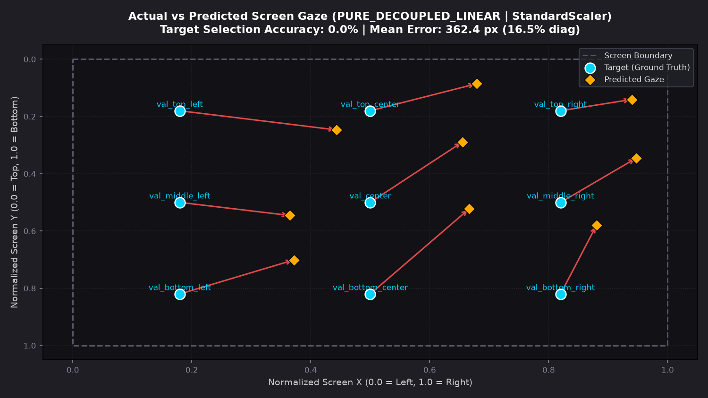
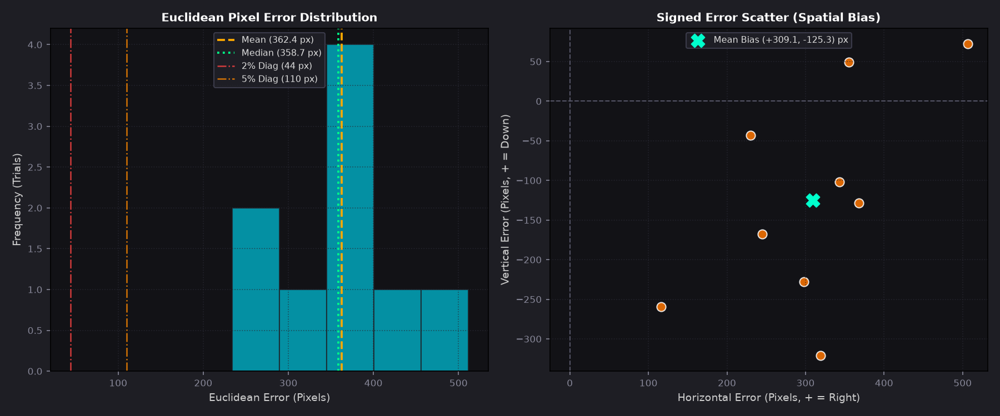
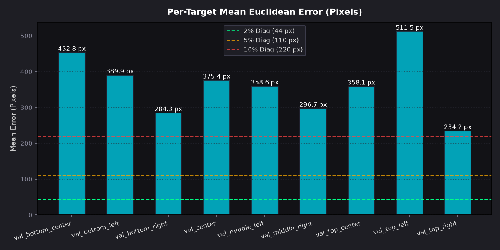

# Gaze Tracking Experiment Report: `experiment_20261127_190029`

## Experiment Overview

| Field | Value |
|---|---|
| **Experiment ID** | `experiment_20261127_190029` |
| **Date and Time** | 2026-11-27 19:01:07 |
| **Screen Resolution** | 1920x1080 (Diagonal: 2202.9 px) |
| **Calibration Model** | PURE_DECOUPLED_LINEAR |
| **Normalization Method** | StandardScaler |
| **Number of Training Samples** | 9 targets (248 accepted frames) |
| **Validation Status** | `COMPLETED` |
| **Number of Validation Trials** | 9 valid / 9 planned (0 rejected, 0.0% rej rate) |

## Main Results

> **Accuracy percentages** below measure how often gaze predictions landed successfully within strict screen tolerances or inside target boundaries (higher is better). **Average Error** measures distance from the true target (lower is better).

| Result | Value |
|---|---:|
| **Accuracy within 2%** | **0.0%** (0/9 trials, within 44.1 px) |
| **Accuracy within 5%** | **0.0%** (0/9 trials, within 110.1 px) |
| **Accuracy within 10%** | **0.0%** (0/9 trials, within 220.3 px) |
| **Target Selection Accuracy** | **0.0%** (0/9 hits) |
| **Average Error (pixels)** | 362.4 px |
| **Average Error (% of screen diagonal)** | 16.5% |
| **Rejected Trial Rate** | 0.0% (0/9) |

## Detailed Results

### Prediction Error Breakdown (Independent Validation Trials)

| Error Measurement | Pixels | Screen Diagonal / Normalized |
|---|---:|---:|
| **X-Axis MAE** | 309.1 px | 0.1610 norm |
| **Y-Axis MAE** | 152.4 px | 0.1411 norm |
| **X-Axis RMSE** | 325.4 px | 0.1695 norm |
| **Y-Axis RMSE** | 178.5 px | 0.1653 norm |
| **Median Error** | 358.7 px | 16.3% diag (0.2256 norm) |
| **Maximum Error** | 511.5 px | 23.2% diag (0.3406 norm) |
| **90th Percentile Error** | 464.5 px | — |

### Target Selection & Trial Counts

- **Target Boundary Evaluated:** Button Box (200x150 px)
- **Successful Selections (Hits):** 0
- **Failed Selections (Misses):** 9
- **Total Valid Trials:** 9
- **Rejected / Invalid Trials:** 0 (0.0%)

### Direction Accuracy Breakdown (LEFT / RIGHT / CENTER / UP / DOWN)

| Direction | Valid / Rej | Selection Accuracy | Within 5% | Mean Error (px) | Bias (X, Y) px |
|---|---:|---:|---:|---:|---:|
| `LEFT` | 3 / 0 | **0.0%** | 0.0% | 420.0 px | (+409.9, -2.2) |
| `RIGHT` | 3 / 0 | **0.0%** | 0.0% | 271.7 px | (+197.1, -156.6) |
| `CENTER` | 1 / 0 | **0.0%** | 0.0% | 375.4 px | (+298.1, -228.0) |
| `UP` | 3 / 0 | **0.0%** | 0.0% | 367.9 px | (+359.9, -24.2) |
| `DOWN` | 3 / 0 | **0.0%** | 0.0% | 375.7 px | (+267.8, -236.4) |

### Screen Region Accuracy Breakdown (Rows, Columns & Edges)

| Screen Region | Valid / Rej | Selection Accuracy | Within 5% | Mean Error (px) | Bias (X, Y) px |
|---|---:|---:|---:|---:|---:|
| `top_row` | 3 / 0 | **0.0%** | 0.0% | 367.9 px | (+359.9, -24.2) |
| `middle_row` | 3 / 0 | **0.0%** | 0.0% | 343.6 px | (+299.4, -115.3) |
| `bottom_row` | 3 / 0 | **0.0%** | 0.0% | 375.7 px | (+267.8, -236.4) |
| `left_column` | 3 / 0 | **0.0%** | 0.0% | 420.0 px | (+409.9, -2.2) |
| `center_column` | 3 / 0 | **0.0%** | 0.0% | 395.4 px | (+320.2, -217.0) |
| `right_column` | 3 / 0 | **0.0%** | 0.0% | 271.7 px | (+197.1, -156.6) |
| `edge_regions` | 8 / 0 | **0.0%** | 0.0% | 360.8 px | (+310.4, -112.5) |
| `center_region` | 1 / 0 | **0.0%** | 0.0% | 375.4 px | (+298.1, -228.0) |

### Per-Target Performance

| Target Point | Valid / Rejected | Hits / Valid | Target Selection Accuracy | Mean Error (px) | Bias (X, Y) px |
|---|---:|---:|---:|---:|---:|
| `val_bottom_center` | 1 / 0 | 0 / 1 | **0.0%** | 452.8 px | (+319.3, -321.1) |
| `val_bottom_left` | 1 / 0 | 0 / 1 | **0.0%** | 389.9 px | (+368.1, -128.5) |
| `val_bottom_right` | 1 / 0 | 0 / 1 | **0.0%** | 284.3 px | (+116.1, -259.5) |
| `val_center` | 1 / 0 | 0 / 1 | **0.0%** | 375.4 px | (+298.1, -228.0) |
| `val_middle_left` | 1 / 0 | 0 / 1 | **0.0%** | 358.6 px | (+355.2, +49.4) |
| `val_middle_right` | 1 / 0 | 0 / 1 | **0.0%** | 296.7 px | (+245.0, -167.4) |
| `val_top_center` | 1 / 0 | 0 / 1 | **0.0%** | 358.1 px | (+343.2, -102.0) |
| `val_top_left` | 1 / 0 | 0 / 1 | **0.0%** | 511.5 px | (+506.4, +72.4) |
| `val_top_right` | 1 / 0 | 0 / 1 | **0.0%** | 234.2 px | (+230.2, -42.9) |

### Training Performance vs. Independent Validation Performance

> **Note:** Training error only measures how tightly the model fits the 9 calibration points and must NOT be interpreted as real-world validation accuracy.

| Evaluation Split | Purpose | Mean Error (px) | Validation Accuracy |
|---|---|---:|---:|
| **Calibration Training Set** | Model fitting residual (training fit only) | 100.4 px | N/A (training split) |
| **Independent Validation Set** | Unseen test targets (real accuracy) | 362.4 px (16.5% diag) | 0.0% hits / 0.0% within 5% |

## Simple Explanation

Status: [COMPLETED]. The system successfully predicted gaze positions inside the target boundaries in 0 out of 9 valid trials (0.0%). Its average prediction error was 362.4 pixels (median: 358.7 px, 16.5% of the screen diagonal), and 0.0% of valid trials fell within 5% of the screen diagonal (0 out of 9). Weakest direction observed: LEFT (mean error 420.0 px); weakest screen region: left_column (mean error 420.0 px). This experiment performed worse than the previous validated experiment (experiment_20261127_185748) according to the independent validation results (average error changed from 327.7 px to 362.4 px (10.6% error increase); target selection accuracy changed from 0.0% to 0.0% (+0.0 percentage points)).

## Comparison with Previous Experiments

| Experiment ID | Model | Norm | Sel Acc | Within 2% | Within 5% | Within 10% | Mean Error | Median | Rej % | Weakest Dir / Region | Status |
| :--- | :---: | :---: | :---: | :---: | :---: | :---: | :---: | :---: | :---: | :--- | :--- |
| `experiment_20261123_221716` | **POLYNOMIAL** | None | N/A | N/A | N/A | N/A | N/A | N/A | N/A | -- | Calibrated Only (No Validation) |
| `experiment_20261123_224241` | **POLYNOMIAL** | None | N/A | N/A | N/A | N/A | N/A | N/A | N/A | -- | Calibrated Only (No Validation) |
| `experiment_20261124_220355` | **POLYNOMIAL** | StandardScaler | N/A | N/A | N/A | N/A | N/A | N/A | N/A | -- | Calibrated Only (No Validation) |
| `experiment_20261124_221738` | **POLYNOMIAL** | StandardScaler | N/A | N/A | N/A | N/A | N/A | N/A | N/A | -- | Calibrated Only (No Validation) |
| `experiment_20261124_225435` | **LINEAR** | StandardScaler | N/A | N/A | N/A | N/A | N/A | N/A | N/A | -- | Calibrated Only (No Validation) |
| `experiment_20261124_225544` | **COMPACT_POLYNOMIAL** | StandardScaler | N/A | N/A | N/A | N/A | N/A | N/A | N/A | -- | Calibrated Only (No Validation) |
| `experiment_20261124_232039` | **LINEAR** | StandardScaler | 0.0% | 0.0% | 0.0% | 33.3% | **423.4 px** | 301.0 px | 0.0% | LEFT / left_column | Validated |
| `experiment_20261124_232710` | **LINEAR** | StandardScaler | 0.0% | 0.0% | 0.0% | 33.3% | **314.8 px** | 319.3 px | 0.0% | UP / top_row | Validated |
| `experiment_20261125_141825` | **COMPACT_LINEAR** | StandardScaler | 0.0% | 0.0% | 0.0% | 33.3% | **312.0 px** | 274.1 px | 0.0% | RIGHT / right_column | Validated |
| `experiment_20261125_142358` | **LINEAR** | StandardScaler | 0.0% | 11.1% | 22.2% | 55.6% | **215.9 px** | 216.3 px | 0.0% | DOWN / bottom_row | Validated |
| `experiment_20261125_150006` | **LINEAR** | StandardScaler | 0.0% | 0.0% | 0.0% | 66.7% | **177.0 px** | 163.5 px | 0.0% | LEFT / left_column | Validated |
| `experiment_20261125_150223` | **DECOUPLED_POLYNOMIAL** | StandardScaler | 11.1% | 11.1% | 77.8% | 100.0% | **95.4 px** | 97.3 px | 0.0% | RIGHT / right_column | Validated |
| `experiment_20261125_153718` | **LINEAR** | StandardScaler | 0.0% | 11.1% | 77.8% | 100.0% | **87.8 px** | 83.2 px | 0.0% | LEFT / left_column | Validated |
| `experiment_20261125_162637` | **COMPACT_POLYNOMIAL** | StandardScaler | 0.0% | 0.0% | 22.2% | 77.8% | **175.3 px** | 173.2 px | 0.0% | CENTER / center_column | Validated |
| `experiment_20261125_162740` | **LINEAR** | StandardScaler | 0.0% | 0.0% | 0.0% | 55.6% | **202.9 px** | 197.1 px | 0.0% | UP / top_row | Validated |
| `experiment_20261125_165544` | **COMPACT_LINEAR** | StandardScaler | 0.0% | 0.0% | 22.2% | 44.4% | **253.3 px** | 229.0 px | 0.0% | UP / top_row | Validated |
| `experiment_20261125_184448` | **DECOUPLED_LINEAR** | StandardScaler | 0.0% | 0.0% | 33.3% | 66.7% | **161.6 px** | 146.5 px | 0.0% | LEFT / left_column | Validated |
| `experiment_20261125_184929` | **DECOUPLED_POLYNOMIAL** | StandardScaler | 0.0% | 0.0% | 0.0% | 55.6% | **316.5 px** | 196.9 px | 0.0% | DOWN / bottom_row | Validated |
| `experiment_20261125_185024` | **DECOUPLED_LINEAR** | StandardScaler | 0.0% | 0.0% | 22.2% | 44.4% | **239.2 px** | 222.4 px | 0.0% | RIGHT / right_column | Validated |
| `experiment_20261125_185607` | **DECOUPLED_LINEAR** | StandardScaler | 55.6% | 22.2% | 55.6% | 100.0% | **93.6 px** | 74.7 px | 0.0% | UP / top_row | Validated |
| `experiment_20261125_185711` | **DECOUPLED_LINEAR** | StandardScaler | N/A | N/A | N/A | N/A | N/A | N/A | N/A | -- | Incomplete (Interrupted) |
| `experiment_20261125_191422` | **DECOUPLED_LINEAR** | StandardScaler | 11.1% | 11.1% | 55.6% | 100.0% | **106.8 px** | 102.7 px | 0.0% | DOWN / bottom_row | Validated |
| `experiment_20261125_192928` | **COMPACT_POLYNOMIAL** | StandardScaler | 0.0% | 0.0% | 11.1% | 44.4% | **253.0 px** | 304.1 px | 0.0% | LEFT / left_column | Validated |
| `experiment_20261125_195146` | **DECOUPLED_LINEAR** | StandardScaler | 0.0% | 0.0% | 0.0% | 44.4% | **345.7 px** | 297.0 px | 0.0% | CENTER / middle_row | Validated |
| `experiment_20261125_195326` | **PURE_DECOUPLED_LINEAR** | StandardScaler | 22.2% | 0.0% | 33.3% | 88.9% | **159.4 px** | 181.6 px | 0.0% | DOWN / center_column | Validated |
| `experiment_20261126_121528` | **DECOUPLED_LINEAR** | StandardScaler | 22.2% | 11.1% | 22.2% | 66.7% | **193.5 px** | 187.2 px | 0.0% | CENTER / center_region | Validated |
| `experiment_20261126_121736` | **DECOUPLED_LINEAR** | StandardScaler | 0.0% | 0.0% | 0.0% | 77.8% | **195.8 px** | 200.9 px | 0.0% | CENTER / center_region | Validated |
| `experiment_20261126_130647` | **PURE_DECOUPLED_LINEAR** | StandardScaler | 0.0% | 0.0% | 0.0% | 0.0% | **561.3 px** | 616.5 px | 0.0% | RIGHT / right_column | Validated |
| `experiment_20261126_130819` | **COMPACT_LINEAR** | StandardScaler | 0.0% | 0.0% | 0.0% | 0.0% | **412.2 px** | 412.0 px | 0.0% | UP / top_row | Validated |
| `experiment_20261126_131018` | **COMPACT_LINEAR** | StandardScaler | 11.1% | 11.1% | 22.2% | 77.8% | **156.2 px** | 161.3 px | 0.0% | RIGHT / right_column | Validated |
| `experiment_20261127_173255` | **PURE_DECOUPLED_LINEAR** | StandardScaler | 0.0% | 0.0% | 0.0% | 22.2% | **304.2 px** | 327.5 px | 0.0% | CENTER / center_column | Validated |
| `experiment_20261127_173522` | **PURE_DECOUPLED_LINEAR** | StandardScaler | 11.1% | 0.0% | 22.2% | 100.0% | **142.6 px** | 136.1 px | 0.0% | CENTER / center_column | Validated |
| `experiment_20261127_182323` | **COMPACT_LINEAR** | StandardScaler | 0.0% | 0.0% | 0.0% | 0.0% | **676.7 px** | 702.5 px | 0.0% | RIGHT / right_column | Validated |
| `experiment_20261127_182414` | **PURE_DECOUPLED_LINEAR** | StandardScaler | 0.0% | 0.0% | 0.0% | 0.0% | **513.0 px** | 564.2 px | 0.0% | LEFT / left_column | Validated |
| `experiment_20261127_184108` | **PURE_DECOUPLED_LINEAR** | StandardScaler | N/A | N/A | N/A | N/A | N/A | N/A | N/A | -- | Incomplete (Interrupted) |
| `experiment_20261127_185112` | **PURE_DECOUPLED_LINEAR** | StandardScaler | 11.1% | 11.1% | 11.1% | 33.3% | **276.4 px** | 266.6 px | 0.0% | LEFT / left_column | Validated |
| `experiment_20261127_185748` | **DECOUPLED_LINEAR** | StandardScaler | 0.0% | 0.0% | 0.0% | 0.0% | **327.7 px** | 299.6 px | 0.0% | UP / center_column | Validated |
| `experiment_20261127_190029` | **PURE_DECOUPLED_LINEAR** | StandardScaler | 0.0% | 0.0% | 0.0% | 0.0% | **362.4 px** | 358.6 px | 0.0% | LEFT / left_column | Validated |

- **Compatibility Warning:** Target button/circle boundaries differ across validated runs.
- **Best Validated Experiment:** `experiment_20261125_185607` (55.6% target selection, 93.6 px mean error) (weakest dir: UP, weakest region: top_row).
- **Lowest Mean Pixel Error:** `experiment_20261125_153718` (87.8 px).
- **Latest vs. Previous Validated (`experiment_20261127_190029` vs `experiment_20261127_185748`):** **GOT WORSE** (Mean Error +34.7 px (10.6% error increase); Target Selection Accuracy +0.0 percentage points; Within 5% Accuracy +0.0 percentage points).

## Diagnostic Plots

