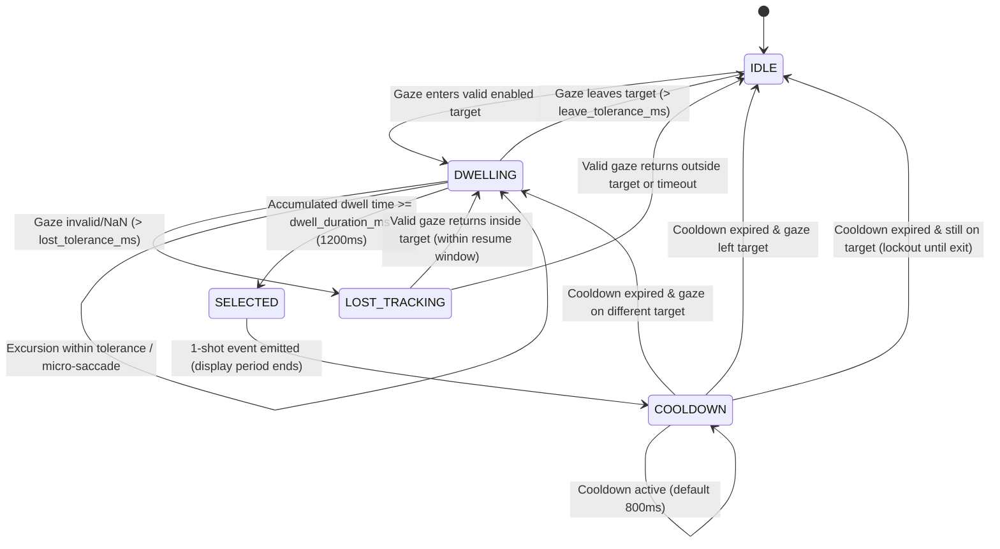

# AABAR — Phase 4: Dwell Selection Engine Documentation

## 1. Overview & Purpose

The **Dwell Selection Engine** is Phase 4 of the **AABAR (عَبْر)** Computer Vision Service for Arabic Augmentative and Alternative Communication (AAC). 

Following the completion and validation of:
- **Phase 1**: Webcam capture, facial and ocular landmarks via MediaPipe Face Mesh.
- **Phase 2**: Iris position extraction, eye openness, 3D head pose, and relative gaze classification.
- **Phase 3**: 9-point screen calibration, Ridge-regularized mapping models (Linear & Polynomial), and independent accuracy validation.

Phase 4 introduces a deterministic, noise-tolerant dwell selection state machine that converts continuous screen gaze coordinates into intentional communicative selections (e.g., triggering AAC symbol buttons such as "YES", "NO", "HELP", "REST") without requiring motor switches or eye blinks.

```text
+-------------------------------------------------------------------------------------------------+
|                                    AABAR CV PIPELINE (PHASE 1 - 3)                              |
|  Webcam Frame -> Landmarks -> 10-D Feature Vector -> Gaze-to-Screen Mapping (norm_x, norm_y)    |
+-------------------------------------------------------------------------------------------------+
                                                |
                                                v
+-------------------------------------------------------------------------------------------------+
|                                 PHASE 4: DWELL SELECTION ENGINE                                 |
|                                                                                                 |
|   +--------------------+      +--------------------+      +---------------------------------+   |
|   |   Target Manager   | ---> | Dwell State Machine| ---> |  Selection Event & Telemetry    |   |
|   | (Bounding Boxes,   |      | (IDLE, DWELLING,   |      | (UUID, Timestamp, Coordinates,  |   |
|   |  Priorities, Crud) |      |  SELECTED, COOLDWN)|      |  Target ID/Label, Progress)     |   |
|   +--------------------+      +--------------------+      +---------------------------------+   |
+-------------------------------------------------------------------------------------------------+
                                                |
                                                v
+-------------------------------------------------------------------------------------------------+
|                                    DOWNSTREAM INTEGRATION                                       |
|               Visualizer Overlay (HUD, Cards, Animated Radial/Linear Progress)                  |
|               Phase 5 Ready: WebSocket / Spring Boot / Angular AAC Interface                    |
+-------------------------------------------------------------------------------------------------+
```

---

## 2. Dwell State Machine Specification

The state machine implements five mutually exclusive states:



### State Definitions:
1. **`IDLE`**: Gaze is either outside all interactive targets or resting on a disabled target. No dwell time accumulates.
2. **`DWELLING`**: Gaze resides inside an active enabled target bounding box. Continuous dwell time accumulates toward `dwell_duration_ms`.
3. **`SELECTED`**: The dwell duration threshold has been reached. A single immutable `SelectionEvent` is emitted. A visual selection flash is active for 200 ms.
4. **`COOLDOWN`**: Post-selection refractory lockout period (default 800 ms). Prevents accidental repeated activations while the user disengages gaze.
5. **`LOST_TRACKING`**: MediaPipe or camera lost tracking (e.g., eye blink, excessive head rotation, occlusion). Dwell progress is frozen during a configurable grace period (default 300 ms) before resetting to `IDLE`.

---

## 3. Configuration Parameters & Defaults

All engine parameters are strongly typed and validated through `DwellConfig`:

| Parameter | Type | Default | Description |
| :--- | :---: | :---: | :--- |
| `dwell_duration_ms` | `int` | `1200` | Gaze fixation duration required to trigger selection (range: 200–5000 ms). |
| `cooldown_duration_ms` | `int` | `800` | Post-selection refractory lockout duration (range: 100–3000 ms). |
| `leave_target_tolerance_ms` | `int` | `200` | Saccade excursion grace window before resetting dwell on target exit. |
| `lost_tracking_tolerance_ms` | `int` | `300` | Grace window during blinks or tracking loss before aborting dwell. |
| `pause_on_lost_tracking` | `bool` | `True` | Freezes dwell progress during brief blinks instead of instantly dropping. |
| `stability_filter_enabled` | `bool` | `True` | Filters gross saccadic jumps (> 0.40 screen distance in consecutive frames). |
| `allow_repeat_without_leaving` | `bool` | `False` | When False, user must look away from the selected card before it can be reselected. |
| `overlap_policy` | `str` | `"highest_priority"` | Target arbitration rule: `"highest_priority"`, `"smallest_area"`, or `"first_defined"`. |
| `coordinate_space` | `str` | `"normalized"` | Coordinate system: `"normalized"` ([0.0, 1.0]) or `"pixel"`. |

---

## 4. Target Management & Geometry

Targets are defined via `DwellTarget` instances with normalized rectangular boundaries:
- `x, y`: Top-left origin coordinates in $[0.0, 1.0]$.
- `width, height`: Normalized dimensions such that $x + width \le 1.0$ and $y + height \le 1.0$.
- `priority`: Integer priority score for overlap resolution (higher integer takes precedence).
- `enabled`: Boolean switch allowing buttons to be deactivated without deleting them.

```python
target = DwellTarget(
    target_id="target_1",
    label="YES",
    x=0.08,
    y=0.08,
    width=0.40,
    height=0.40,
    priority=10,
    enabled=True,
    data={"action": "affirmative", "arabic": "نعم"}
)
```

### Overlap Arbitration Policies
When multiple target bounding boxes overlap:
1. **`highest_priority`** (Default): Selects the target with maximum `priority`.
2. **`smallest_area`**: Selects the target with minimal bounding area ($w \times h$), supporting nested buttons.
3. **`first_defined`**: Deterministic fallback selecting the earliest registered target.

---

## 5. Noise Handling & Gaze Stability

Webcam gaze tracking contains natural jitter, micro-saccades, and physiological blinks. The engine handles these through four defenses:

1. **Saccade Excursion Grace (`leave_target_tolerance_ms=200`)**: If the user's gaze briefly flickers outside the bounding box for less than 200 ms during fixation, dwell progress is paused rather than instantly discarded. If gaze returns inside within the grace window, accumulation resumes smoothly.
2. **Blink & Tracking Loss Freeze (`lost_tracking_tolerance_ms=300`)**: Involuntary blinks (~150–250 ms) do not abort the dwell cycle. The engine transitions to `LOST_TRACKING` and holds the accumulated time frozen until tracking re-establishes.
3. **Gross Saccade Outlier Filtering**: Sudden jumps across the entire screen ($> 0.40$ normalized diagonal in a single cycle) are flagged as saccades and do not trigger target entry until fixation stabilizes.
4. **NaN / Inf Coordinate Immunity**: Non-finite coordinates from loss of facial landmarks are strictly intercepted at `_validate_gaze_input()` and routed into safe tracking-loss handling without throwing exceptions.

---

## 6. Selection Event & Telemetry Schema

When selection criteria are satisfied, the engine emits an immutable `SelectionEvent`:

```json
{
  "event_id": "c4b31a89-216e-4f10-9189-9800a74d28e4",
  "timestamp": 1732549215.421,
  "target_id": "target_1",
  "target_label": "YES",
  "gaze_x": 0.2854,
  "gaze_y": 0.3210,
  "dwell_duration_ms": 1205.2,
  "selection_state": "CONFIRMED",
  "metadata": {
    "priority": 10,
    "action": "affirmative",
    "arabic": "نعم"
  }
}
```

On every processing cycle, `DwellSnapshot` provides real-time UI telemetry:
- `state`: Current `DwellState` enum.
- `current_target_id`: ID of target currently being dwelt upon.
- `current_target_label`: Human-readable label.
- `dwell_time_ms`: Milliseconds accumulated inside target.
- `dwell_progress`: Value clamped to $[0.0, 1.0]$ for progress bars.
- `remaining_time_ms`: Milliseconds until selection triggers.
- `cooldown_progress`: Value clamped to $[0.0, 1.0]$ indicating cooldown recovery.
- `selection_event`: Non-null only on the single frame where selection is triggered.

---

## 7. Pipeline & UI Visualizer Integration

The Dwell Selection Engine is integrated directly into `CVPipeline`:
- Activated via `pipeline.toggle_dwell_selection()` or CLI flag `--dwell`.
- Frame predictions from `active_mapper` (or fallback baseline gaze) feed into `dwell_engine.update(norm_x, norm_y)`.
- Results are appended to `GazeFrameResult.dwell` for structured serialization.
- `CVVisualizer` renders:
  - AAC Target cards with dynamic alpha-blended backgrounds.
  - Animated dwell progress bars along the card bottom edge.
  - Distinct state coloring:
    - **IDLE**: Neutral dark slate outline.
    - **DWELLING**: High-contrast cyan border with pulsing reticle.
    - **SELECTED**: Vibrant green flash with `[SELECTED!]` banner.
    - **COOLDOWN**: Orange/amber border with `[LOCKED]` countdown bar.
    - **DISABLED**: Dimmed grayscale card with `(OFF)` suffix.
  - Pulsing gaze reticle showing live user gaze position.

---

## 8. Interactive Testing & Verification

### Running the Manual Mouse Demo
Test dwell selection immediately without a webcam using your mouse cursor:
```bash
cd cv-service
python -m dwell.manual_demo --mouse
```
- Hover over "YES", "NO", "HELP", "REST" cards to observe dwell timing and selection.
- Press `1`–`4` to toggle cards enabled/disabled.
- Press `t` to simulate tracking loss / blink.
- Press `r` to manually reset dwell state.
- Press `+` / `-` to adjust dwell duration in real-time.

### Running with Live Webcam
```bash
cd cv-service
python main.py --dwell --dwell-demo
```

### Running Automated Test Suite
The complete regression test suite comprises 149 automated tests, including 27 dedicated Phase 4 dwell tests:
```bash
cd cv-service
MPLCONFIGDIR=/tmp/mpl_test .venv/bin/pytest tests/test_target_manager.py tests/test_dwell_state.py tests/test_dwell_engine.py -v
```

---

## 9. Phase 5 Integration Readiness

The Dwell Selection Engine is architected to feed directly into Phase 5 (AAC Communication Interface & WebSockets):
1. **Zero UI Coupling**: The engine depends solely on numeric coordinates, allowing it to run headless on a server, edge device, or inside a WebSocket streaming thread.
2. **Event Observer Pattern**: Upstream consumers register handlers via `engine.on_selection(callback)`.
3. **Structured JSON Serialization**: Every selection event and frame snapshot implements `.to_dict()`, ready for JSON serialization across WebSocket connections to Spring Boot and Angular frontends.
